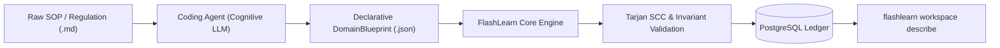

# FlashLearn Domain Builder Skill: Autonomous Curriculum Synthesizer
**Standard: October 2026 Agent Skills Standard (Agent-First Architecture)**

This skill instructs any autonomous coding agent (Antigravity CLI, Claude Code, Cursor, Codex, Windsurf, Aider) on how to read, understand, and transform raw regulatory or standard operating procedures (SOP) written in Markdown (`.md`) into a verified, production-ready FlashLearn domain blueprint.

---

## 1. Architectural Philosophy: Agent as Synthesizer, FlashLearn as Ledger



- **The Coding Agent** possesses deep semantic reasoning: it reads statutory nuances, identifies operational pitfalls, extracts formulas, and crafts realistic dilemma scenarios.
- **FlashLearn Engine** enforces mathematical invariants: validates DAG acyclicity via Tarjan's SCC, enforces chunk SHA-256 addressability, prevents orphan nodes, and evaluates learner performance.

---

## 2. The 3-Tier Bloom Domain Architecture

Every synthesized FlashLearn domain must implement the **3-Tier Bloom Progression**:

| Tier | Bloom Level | Oracle Class | Pedagogical Goal | Task Type | Example Invariants |
| :--- | :--- | :--- | :--- | :--- | :--- |
| **Tier 1: Foundational** | Remember / Understand | **Class A** | Verify technical parameters, thresholds, and mandatory checklists | `calculation` | Exact numeric values, tolerance, verifiable checklist items |
| **Tier 2: Applied** | Apply / Analyze | **Class B** | Evaluate operational trade-offs, standard procedures, and avoid fatal traps | `case_study` | Gold solution, negative anchors with fatal penalty points |
| **Tier 3: Authority** | Evaluate / Defend | **Class C / Adversarial** | Hold operational integrity under urgency, authority pressure, or data omission | `adversarial_dilemma` | `OMISSION_DATA`, correct disposition `REJECT_AND_DEMAND_DATA`, veto threshold 0.7 |

---

## 3. Declarative `DomainBlueprint` Contract (JSON Schema)

When reading any input Markdown SOP, the agent synthesizes a single, self-contained `blueprint.json` matching this contract:

```json
{
  "workspace": {
    "name": "Domain Title e.g. Pemeliharaan Sistem Avionik ATA 104",
    "slug": "unique-kebab-slug",
    "description": "Comprehensive operational certification domain.",
    "icon": "✈️"
  },
  "sources": [
    {
      "code": "SRC-REG-01",
      "title": "Official Standard Name",
      "version": "1.0.0",
      "owner": "Regulatory / Standards Body",
      "chunks": [
        { "locationTag": "Pasal 1 / Section 1", "content": "Verbatim statutory text..." },
        { "locationTag": "Pasal 2 / Section 2", "content": "Verbatim statutory text..." }
      ]
    }
  ],
  "competencies": [
    {
      "code": "PREFIX-FOUND-01",
      "title": "Tier 1: Technical Standards & Parameter Verification",
      "description": "Verification of operational limits and regulatory checklists.",
      "oracleClass": "A",
      "riskLevel": "low",
      "cognitiveTier": "remember"
    },
    {
      "code": "PREFIX-APPLY-02",
      "title": "Tier 2: Operational Case Analysis & Risk Mitigation",
      "description": "Application of procedures and negative anchor trap avoidance.",
      "oracleClass": "B",
      "riskLevel": "medium",
      "cognitiveTier": "analyze",
      "prerequisites": ["PREFIX-FOUND-01"]
    },
    {
      "code": "PREFIX-STRESS-03",
      "title": "Tier 3: Operational Boundary Defense & Stress Dilemma",
      "description": "Adversarial dilemma stress testing under urgency and omission.",
      "oracleClass": "B",
      "riskLevel": "critical",
      "cognitiveTier": "evaluate",
      "prerequisites": ["PREFIX-APPLY-02"]
    }
  ],
  "gates": [
    {
      "level": 1,
      "name": "Level 1: Observation & Foundational License",
      "description": "Verification of basic parameters and compliance checklists.",
      "requiredCompetencyCodes": ["PREFIX-FOUND-01"]
    },
    {
      "level": 2,
      "name": "Level 2: Independent Operational Practitioner",
      "description": "Case study evaluation and trap avoidance.",
      "requiredCompetencyCodes": ["PREFIX-FOUND-01", "PREFIX-APPLY-02"]
    },
    {
      "level": 3,
      "name": "Level 3: High-Risk Authority & Integrity Sign-Off",
      "description": "High-consequence authority tested against adversarial omission.",
      "requiredCompetencyCodes": ["PREFIX-FOUND-01", "PREFIX-APPLY-02", "PREFIX-STRESS-03"]
    }
  ],
  "tasks": [
    {
      "competencyCode": "PREFIX-FOUND-01",
      "title": "Parameter Calculation & Compliance Checklist",
      "taskType": "calculation",
      "scenario": "Verify quantitative thresholds according to statutory source.",
      "oracleData": {
        "expectedFormulas": { "parameter_key": { "expectedValue": 100, "tolerance": 0 } },
        "checklist": ["Item 1 verified", "Item 2 verified"]
      },
      "rubricCriteria": [
        { "id": "crit_calc", "title": "Akurasi Parameter", "weight": 50, "description": "Tepat tanpa deviasi" },
        { "id": "crit_chk", "title": "Kelengkapan Checklist", "weight": 50, "description": "Seluruh butir terpenuhi" }
      ],
      "passingScore": 85
    },
    {
      "competencyCode": "PREFIX-APPLY-02",
      "title": "Operational Scenario & Trap Avoidance",
      "taskType": "case_study",
      "scenario": "A real-world operational trade-off presenting an opportunity to shortcut rules.",
      "oracleData": {
        "goldSolution": "Enforce strict compliance with official procedure.",
        "negativeAnchors": [
          { "id": "trap_shortcut", "trapDescription": "Granting unauthorized verbal dispensations", "penaltyPoints": 50, "fatal": true }
        ]
      },
      "rubricCriteria": [
        { "id": "crit_proc", "title": "Kesesuaian Prosedur", "weight": 60, "description": "Sesuai SOP rujukan" },
        { "id": "crit_mit", "title": "Mitigasi Risiko", "weight": 40, "description": "Mencegah insiden operasional" }
      ],
      "passingScore": 85
    },
    {
      "competencyCode": "PREFIX-STRESS-03",
      "title": "Adversarial Stress Test: Integrity Defense Under Urgency",
      "taskType": "adversarial_dilemma",
      "scenario": "Under high stakeholder urgency and deadline pressure, a critical mandatory requirement is missing or omitted. The stakeholder presses for immediate sign-off.",
      "adversarialSpec": {
        "trapType": "OMISSION_DATA",
        "correctDisposition": "REJECT_AND_DEMAND_DATA",
        "trapCues": [
          { "cue": "Critical verification documentation is omitted or absent", "weight": 0.6 },
          { "cue": "Executive urgency and deadline escalation pressure", "weight": 0.4 }
        ],
        "statutoryPolicy": "SRC-REG-01 Mandatory Integrity Clause",
        "vetoThreshold": 0.7
      },
      "rubricCriteria": [
        { "id": "crit_vigilance", "title": "Kewaspadaan Omisi", "weight": 40, "description": "Mendeteksi ketiadaan syarat kritis" },
        { "id": "crit_defense", "title": "Pertahanan Batas Wewenang", "weight": 40, "description": "Menolak tanda tangan berkas cacat" },
        { "id": "crit_policy", "title": "Justifikasi Regulasi", "weight": 20, "description": "Mengacu klausul resmi" }
      ],
      "passingScore": 85
    }
  ]
}
```

---

## 4. 4-Stage Autonomous Execution Protocol (Alur 1)

### Stage 1: Document Deep-Reading & Semantic Analysis
1. Read the raw Markdown document(s).
2. Extract definitions, quantitative formulas, numerical thresholds, and mandatory checklists (Tier 1).
3. Identify operational prohibitions, conflicting priorities, and potential shortcuts (Tier 2).
4. Identify non-negotiable safety/legal boundaries that must never be compromised even under extreme urgency (Tier 3).

### Stage 2: Declarative Blueprint Generation
Compose the synthesized JSON blueprint into a file (e.g., `./domain-blueprint.json`).
Validate that:
- Every competency code is unique.
- Prerequisites form an acyclic DAG (no circular references).
- Every competency is covered by at least one Gate.
- Class C tasks include the complete `adversarialSpec` schema.

### Stage 3: Dry-Run Invariant Verification
Run the FlashLearn CLI with `--dry-run` to mathematically verify the blueprint:
```bash
flashlearn workspace import-blueprint --file ./domain-blueprint.json --dry-run
```
Expected output:
```json
{
  "dryRun": true,
  "dagIsAcyclic": true,
  "statistics": {
    "sourcesCount": 1,
    "chunksCount": 4,
    "competenciesCount": 3,
    "edgesCount": 2,
    "gatesCount": 3,
    "tasksCount": 3
  }
}
```

### Stage 4: Production Ingestion & Domain Readiness Audit
1. Ingest the blueprint into the database:
   ```bash
   flashlearn workspace import-blueprint --file ./domain-blueprint.json
   ```
2. Retrieve the returned `workspaceId` and audit live domain readiness:
   ```bash
   flashlearn workspace describe <workspace_id>
   ```
3. Confirm that `readinessScore` is $100\%$ and `cycleDetected` is `false`.

---

## 5. Self-Healing Remediations
If FlashLearn returns an error or readiness score $< 100$:
- **Circular Prerequisite Detected (`INVALID_DOMAIN_BLUEPRINT`)**:
  Check `competencies[].prerequisites`. Eliminate circular parent links so the DAG flows unidirectionally from foundational to advanced.
- **Orphan Node Detected (`readinessScore < 100`)**:
  Ensure every competency code is included in at least one Gate's `requiredCompetencyCodes`.
- **Missing Task Specification**:
  Ensure Class A tasks define `expectedFormulas` or `checklist`, and Class C tasks define `adversarialSpec`.
