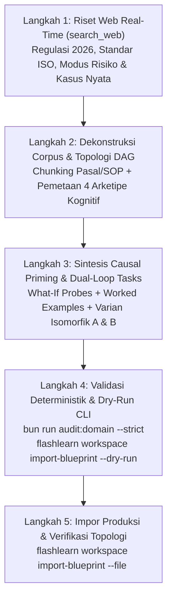

# 🏗️ FlashLearn Domain Synthesizer & Builder (`flashlearn-domain-builder`)

Skill ini digunakan oleh Coding Agent untuk **membangun (mensintesis) domain kurikulum baru secara otonom dari nol** (dari dokumen SOP mentah, peraturan perundang-undangan, atau brief topik industri) ke dalam format **Universal Domain Blueprint JSON**, memvalidasinya, dan mengimpornya ke platform FlashLearn menggunakan **Agent-First CLI** (`bun run cli`).

Seluruh kurikulum yang dibangun wajib mengimplementasikan temuan meta-analisis dan arsitektur kognitif FlashLearn v2.0 (*Bastani et al., 2025; Anderson, 1982; Borders et al., 2024; Mazzone et al., 2020*).

---

## 🎯 6 Invarian Inti Kurikulum Domain (Quality Pillars)

Setiap blueprint domain yang dibangun wajib mematuhi 6 pilar berikut tanpa pengecualian:

| No | Pilar Kognitif | Spesifikasi Teknis Wajib di Blueprint | Tujuan / Mitigasi Failure Mode |
|:---|:---|:---|:---|
| **1** | **Corpus of Record** | `sources[].chunks[]` dengan `locationTag` eksplisit (Pasal/Bab/Ayat) dan kutipan verbatim. | Mencegah halusinasi; setiap evaluasi wajib memiliki dasar hukum/SOP tertulis. |
| **2** | **Acyclic Competency DAG** | 4 tingkatan kompetensi (`remember` $\to$ `apply` $\to$ `analyze` $\to$ `evaluate`) dengan `cognitiveArchetype` spesifik. Graf wajib lolos uji Tarjan SCC (bebas siklus). | Mencegah lompatan kognitif (*Draw the rest of the owl*) dan *circular prerequisite trap*. |
| **3** | **Causal Schema Priming** | Setiap kompetensi memiliki probe: *What-If prediction* (dengan opsi pilihan dan alasan kausal), *analogical comparison* (Skenario A vs B), atau *micro-debugging* snippet cacat. | Mengatasi *knowing-doing gap* (*Anderson, 1982; Borders et al., 2024*); memaksa nalar sebab-akibat sebelum eksekusi. |
| **4** | **Dual-Loop Scaffolding** | `workedExamples` terbedah (langkah demi langkah + *common traps / negative anchors*) dan `microSandbox` bertahap dengan checkpoint mandiri (*unaided practice*). | Mencegah *The Assessment-as-Instruction Fallacy*; memisahkan mode latihan bebas penalti dari ujian wewenang. |
| **5** | **Multi-Observation Tasks** | Setiap tugas evaluasi inti memiliki minimal 2 varian isomorfik (`scenarioVariantCode: "variant_a"` dan `"variant_b"`) dengan struktur dalam identik namun konteks permukaan berbeda. | Menjamin *entrustment* otentik (*Mazzone et al., 2020*); mencegah *lucky guess* atau *surface pattern matching*. |
| **6** | **Adversarial Stress Test** | Minimal 1 tugas bertipe `adversarial_dilemma` dengan `adversarialSpec` (tipe jebakan: tekanan otoritas, desakan waktu, atau omisi data; batas veto $\ge 70\%$). | Menguji integritas dan daya tahan pemegang wewenang terhadap tekanan dunia nyata (*anti-fraud*). |

---

## 🔄 Alur Kerja Agen 5-Tahap (The 5-Step Synthesis Loop)



---

### Langkah 1: Riset Web Real-Time (Mandatory Live Internet Research)
Sesuai **User Rule #11**, agen **DILARANG MENGANDALKAN ASUMSI PRE-TRAINED SAJA**. Jalankan `search_web` per standar tahun 2026:
1. **Regulasi & Standar Baku**: Cari undang-undang, keputusan menteri, atau ISO/NIST terbaru yang mengatur domain target di Indonesia atau internasional.
2. **Kasus Nyata & Modus Fraud/Kegagalan**: Cari temuan audit (BPK, BPKP, Internal Audit, FAA, FDA, dll.), sengketa hukum, atau anomali operasional untuk dijadikan *negative anchors* dan *adversarial dilemmas*.
3. **Taksonomi Kompetensi**: Cari silabus sertifikasi profesi resmi untuk menyusun urutan prasyarat pembelajaran yang realistis.

---

### Langkah 2: Penyusunan Blueprint JSON
Buat berkas blueprint di `docs/samples/<nama-domain>-blueprint.json` dengan format standar:

```json
{
  "version": "2.0.0",
  "workspace": {
    "name": "Nama Domain Lengkap",
    "slug": "nama-domain-slug",
    "description": "Deskripsi ruang lingkup wewenang dan tata kelola domain.",
    "icon": "🏢"
  },
  "sources": [
    {
      "code": "SRC-DOMAIN-2026",
      "title": "SOP / Regulasi Standar Operasional Resmi",
      "version": "1.0",
      "owner": "Komite Otoritas Domain",
      "effectiveDate": "2026-01-01",
      "chunks": [
        {
          "locationTag": "Pasal 1 (Prinsip Pokok)",
          "content": "Kutipan verbatim aturan, ambang batas, atau definisi yuridis/teknis."
        }
      ]
    }
  ],
  "competencies": [
    {
      "code": "DOM-01",
      "title": "Judul Kompetensi Fondasi",
      "description": "Deskripsi operasional keterampilan yang dikuasai.",
      "oracleClass": "A",
      "cognitiveArchetype": "artifact_audit",
      "riskLevel": "low",
      "cognitiveTier": "remember"
    },
    {
      "code": "DOM-02",
      "title": "Judul Kompetensi Kalkulasi / Analisis",
      "description": "Kemampuan menerapkan formula kuantitatif atau telaah kritis.",
      "oracleClass": "A",
      "cognitiveArchetype": "algorithmic_quant",
      "riskLevel": "medium",
      "cognitiveTier": "apply",
      "prerequisites": ["DOM-01"]
    }
  ],
  "prerequisiteEdges": [
    { "sourceCompetencyCode": "DOM-01", "targetCompetencyCode": "DOM-02" }
  ],
  "gates": [
    {
      "level": 0,
      "title": "Level 0 · Observasi & Kepatuhan Dasar",
      "description": "Izin pendampingan di bawah pengawasan supervisor tanpa hak eksekusi mandiri."
    },
    {
      "level": 1,
      "title": "Level 1 · Staf Pelaksana Operasional",
      "description": "Wewenang menjalankan transaksi atau prosedur rutin sesuai SOP."
    }
  ],
  "tasks": [
    {
      "competencyCode": "DOM-02",
      "title": "Kalkulasi Nilai Kritis [Varian A]",
      "scenario": "Skenario operasional konkret dengan parameter data uji kasus A...",
      "taskType": "calculation",
      "scenarioVariantCode": "variant_a",
      "isIsomorphicVariant": false,
      "passingScore": 85,
      "oracleData": {
        "expectedFormulas": {
          "hasilAkhir": { "expectedValue": 15000000, "tolerance": 0.01 }
        },
        "oracleConfig": {
          "rolePersona": "Auditor Senior Kepatuhan Operasional",
          "strictnessLevel": "strict",
          "dos": ["Wajib memverifikasi batas toleransi 1%"],
          "donts": ["Dilarang meloloskan jika pembulatan menyimpang"]
        },
        "socraticConfig": {
          "pedagogicalRole": "Mentor Analisis Kuantitatif",
          "pedagogicalStyle": "scaffolded",
          "dos": ["Arahkan peserta mengecek kembali perkalian faktor pengali"],
          "donts": ["Dilarang menyebutkan angka hasil akhir 15000000"]
        }
      },
      "rubricCriteria": [
        { "id": "rc1", "title": "Akurasi Perhitungan", "weight": 60, "description": "Kesesuaian formula." },
        { "id": "rc2", "title": "Kelengkapan Parameter", "weight": 40, "description": "Semua faktor terhitung." }
      ]
    },
    {
      "competencyCode": "DOM-02",
      "title": "Kalkulasi Nilai Kritis [Varian B - Isomorfik]",
      "scenario": "Skenario operasional yang sama dengan data angka berbeda untuk pengamatan kedua...",
      "taskType": "calculation",
      "scenarioVariantCode": "variant_b",
      "isIsomorphicVariant": true,
      "passingScore": 85,
      "oracleData": {
        "expectedFormulas": {
          "hasilAkhir": { "expectedValue": 24000000, "tolerance": 0.01 }
        }
      },
      "rubricCriteria": [
        { "id": "rc1", "title": "Akurasi Perhitungan", "weight": 60, "description": "Kesesuaian formula." },
        { "id": "rc2", "title": "Kelengkapan Parameter", "weight": 40, "description": "Semua faktor terhitung." }
      ]
    }
  ]
}
```

---

### Langkah 3: Validasi Deterministik Monorepo
Sebelum melakukan impor ke database, jalankan auditor kurikulum monorepo:
```bash
# 1. Audit struktur 5 pilar (Strict mode wajib exit code 0)
bun run audit:domain --file docs/samples/<nama-domain>-blueprint.json --strict

# 2. Periksa graf asiklis & statistik blueprint via CLI Dry-Run
bun run cli workspace import-blueprint --file docs/samples/<nama-domain>-blueprint.json --dry-run
```

Jika terjadi siklus DAG (*circular loop*) atau bobot rubrik tidak berjumlah 100%, linter akan melempar pesan kegagalan spesifik (*fail-fast throw*). Perbaiki blueprint hingga audit menghasilkan skor 100% `PRODUCTION_READY`.

---

### Langkah 4: Impor Permanen via Agent-First CLI
Setelah validasi lulus, lakukan impor deklaratif ke engine FlashLearn:
```bash
# Eksekusi impor permanen
bun run cli workspace import-blueprint --file docs/samples/<nama-domain>-blueprint.json
```

Output CLI akan mengembalikan envelope JSON standar:
```json
{
  "code": "OK",
  "data": {
    "workspaceId": "uuid-...",
    "slug": "nama-domain-slug",
    "sourcesCreated": 1,
    "competenciesCreated": 5,
    "edgesCreated": 4,
    "gatesCreated": 4,
    "tasksCreated": 10
  }
}
```

---

### Langkah 5: Verifikasi Bukti Pasca-Impor
Pastikan domain terdaftar dan graf prasyarat terhubung sempurna:
```bash
# 1. Cek ringkasan domain
bun run cli workspace describe <workspace_id>

# 2. Cek topologi graf kompetensi
bun run cli competency graph --workspace-id <workspace_id>

# 3. Cek daftar authorization gates
bun run cli gate list --workspace-id <workspace_id>
```

---

## 🚫 Larangan & Anti-Pola Keras (Strict Prohibitions)
1. **Dilarang Menulis Hardcode di Core Engine**: Jangan pernah memasukkan istilah atau aturan spesifik domain (misal: "kemenkeu", "boeing", "pasien", "tender") ke dalam folder `apps/api/src/domain/` atau `apps/web/`. Seluruh logika domain wajib berada 100% di dalam payload blueprint JSON.
2. **Dilarang Soal Pilihan Ganda Trivia Tunggal**: Setiap kompetensi wajib menguji kompetensi prosedural (kalkulasi deterministik, deteksi cacat dokumen, atau penyelesaian dilema).
3. **Dilarang Ujian Satu Observasi**: Setiap tugas target wajib memiliki minimal 2 varian isomorfik (`variant_a` dan `variant_b`) untuk memenuhi syarat Multi-Observation Entrustment.
4. **Dilarang Mock / Fake Test Data di Jalur Produksi**: Seluruh blueprint wajib berisi data standar riil yang dapat diverifikasi oleh auditor.
