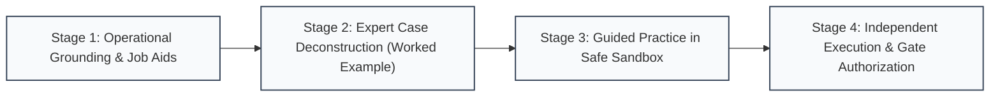

# 1. Introduction and Goals

> [!INFO] **Architecture Provenance & Freshness**
> - **Verified Commit**: `724e04d` (branch: `main`)
> - **Verified Timestamp**: `2026-10-25T22:32:00+07:00`
> - **Tracked Paths**: `apps/`, `packages/`, `scripts/`
> - **Drift Status**: `verified`

The primary goal of FlashLearn is:
**To produce human resources who are genuinely ready to be entrusted with real-world operational responsibilities, and who can execute those responsibilities properly, accurately, and independently by progressing through systematic learning stages prepared by the system.**

In critical operational domains (such as public procurement, engineering, aviation, healthcare, and financial compliance), traditional corporate training frequently fails because it tests people on theoretical knowledge without ever preparing them to execute real tasks. Learners pass exams by memorizing definitions, but when given real operational authority on the job, they make costly errors, overlook compliance risks, or freeze under pressure.

FlashLearn eliminates this disconnect. Instead of assuming learners can perform complex tasks after reading brief text, the system provides an evidence-based progression that systematically builds competence, demystifies expert procedures, and rigorously verifies capability before granting operational authority.

---

## 1.1 The Step-by-Step Learning Progression to Job Readiness

To ensure that learners become truly capable of handling real-world responsibility, FlashLearn guides them through four structured learning stages for every competency:

### Stage 1: Operational Grounding & Job Aids (Understanding Rules & Tools)
- Learners are equipped with practical operational tools: standard operating procedures (SOPs), working checklists, calculation formulas, and statutory references.
- Rather than abstract academic theories, learners understand the operational boundaries, regulatory mandates, and success criteria governing the responsibility they will hold.

### Stage 2: Expert Case Deconstruction (Learning from Solved Real Cases)
- Learners study complete, realistic cases already solved by industry experts from beginning to end.
- Every line of decision-making, calculation, and document review is annotated: *Where did this data originate? Which rule was applied? What common trap or mistake frequently causes novices to fail at this step?*
- This eliminates guesswork and establishes a solid mental model of how an expert executes the responsibility.

### Stage 3: Guided Practice in a Safe Sandbox (Building Execution Instincts)
- Learners practice executing real tasks in an interactive, penalty-free environment.
- Complex tasks are structured progressively (e.g. starting with pre-filled templates where learners complete key decision checkpoints) with immediate diagnostic feedback on sub-steps.
- Learners are encouraged to struggle and correct mistakes without fear of failing or damaging their official record, building genuine procedural confidence.

### Stage 4: Independent Proof of Capability & Gate Authorization (Earning Responsibility)
- Once the learner demonstrates fluency in practice, they enter the formal assessment to prove independent capability.
- The learner must execute an authentic task without hints or shortcuts, evaluated against deterministic standards (exact calculation tolerances, complete compliance checks, or grounded case rubrics).
- Passing this stage unlocks the corresponding operational authority level, providing leadership and organizations with verifiable confidence that the individual is ready to perform.

---

## 1.2 Quality Goals (Q42 Model)

The following quality goals ensure that FlashLearn delivers on its core promise of producing job-ready talent reliably and securely:

| Priority | Quality Tag | Quality Goal | Description & Target Metric |
|---|---|---|---|
| 1 | #correctness | Operational Competence & Alignment Guarantee | Zero gap between learning materials and task demands. Every requirement in Stage 4 exams must be preceded by explicit demonstration in Stages 1–3. Mathematical calculations adhere to strict tolerances ($\le \pm 1\%$), and qualitative assessments are strictly grounded in authoritative source documents. |
| 2 | #maintainability | Modular Architecture & Production Integrity | The system architecture remains strictly modular and maintainable. 100% of codebase files adhere to Single Responsibility limits (< 400 lines/file via `bun run lint:srp`). Zero mock implementations or fake latency in production execution pathways (`detect-mocks .`). |
| 3 | #performance | Responsive Learning Flow & Resource Efficiency | The user experience remains fluid and distraction-free with sub-50ms P95 API response times and 120Hz smooth UI transitions. The containerized system runs efficiently with memory consumption under 256MB RAM on standard enterprise infrastructure. |
| 4 | #security | Tamper-Proof Audit Trails & Credential Trust | Operational authorization decisions must be beyond dispute. Attempt history, evaluation scores, and source citations are anchored with SHA-256 cryptographic hashes, and authority passports are digitally signed with Ed25519 keys (W3C Verifiable Credentials) for tamper-evident verification. |

---

## 1.3 Stakeholders & Operational Beneficiaries

| Stakeholder / Persona | Role & Context | Primary Need & Expected Value |
|---|---|---|
| **Learner / Candidate** | Professional acquiring new responsibilities | Needs transparent, step-by-step guidance without sudden exam traps; needs a safe space to practice before being judged; desires portable, undeniable proof of genuine competence. |
| **Organizational Leader / Authority Delegator** | Division head, project director, or hiring manager | Needs uncompromised assurance that employees delegated with critical duties (signing contracts, approving budgets, operating equipment) will execute them correctly and without costly failures. |
| **Domain Curriculum Author** | Senior practitioner or SME creating training | Needs a structured workflow to translate complex real-world responsibilities into clear learning stages without having to manually author dozens of variations from scratch. |
| **Compliance & Quality Auditor** | Regulatory or governance inspector | Requires immutable, auditable proof that certified personnel have demonstrated mastery over statutory requirements (Corpus of Record) through verifiable evaluation records. |
| **System Operator** | Platform & DevOps engineer | Demands a deterministic, stable, and low-resource platform with automated regression gates, hermetic test suites, and zero downtime deployments. |
