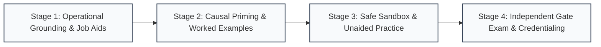

# 1. Introduction and Goals

> [!INFO] **Architecture Provenance & Freshness**
> - **Verified Commit**: `df7d251` (branch: `main`)
> - **Verified Timestamp**: `2026-11-22T12:50:40+07:00`
> - **Tracked Paths**: `apps/`, `packages/`, `scripts/`
> - **Drift Status**: `verified`

The primary goal of FlashLearn is:
**To produce human resources who are genuinely ready to be entrusted with real-world operational responsibilities, and who can execute those responsibilities properly, accurately, and independently by progressing through systematic learning stages prepared by the system.**

In critical operational domains (such as public procurement, software architecture, engineering, aviation, healthcare, and statistical mapping), traditional corporate training frequently fails because it tests people on theoretical recall without preparing them to execute real tasks. Learners pass exams by memorizing definitions, yet struggle or violate compliance boundaries under real operational pressure.

FlashLearn eliminates this disconnect through an evidence-based progression that builds procedural mental models, grounds every reference in a verbatim *Corpus of Record*, verifies capability via multi-tier oracles, and issues cryptographically verifiable authority credentials.

---

## 1.1 The Step-by-Step Learning Progression to Job Readiness

For every competency node in a domain DAG, FlashLearn structures learning into four progressive stages:

### Stage 1: Operational Grounding & Job Aids
- Learners review domain-specific *Corpus of Record* excerpts (`source_chunks`), operational checklists, calculation formulas, and statutory citations loaded directly from the database.

### Stage 2: Causal Schema Priming & Expert Case Deconstruction
- Learners interact with causal prediction probes (*What-If* flashcards, analogical comparisons, micro-debugging) and inspect domain-agnostic isomorphic worked examples derived dynamically from task specifications.

### Stage 3: Safe Sandbox & Unaided Practice Checkpoint
- Learners practice inside the penalty-free Sandbox tab (with optional Socratic AI guidance) and complete the mandatory **Unaided Practice Checkpoint** (`POST /api/v1/competencies/:id/unaided-sandbox-pass` or unaided practice attempt) before unlocking formal evaluation.

### Stage 4: Independent Gate Exam & Gate Authorization
- Inside the formal Gate Exam tab (`GateExamTab.svelte`), the AI Tutor is disabled (`disableAiTutor={true}`). Submissions are evaluated by Multi-Tier Oracles (Class A deterministic, Class B AI judge, Class C human consensus).
- Passing required competencies and multi-observation variant thresholds unlocks Progressive Authorization Gates and W3C Verifiable Credentials (`DataIntegrityProof` with `eddsa-rdfc-2022`).

---

## 1.2 Quality Goals (Q42 Model)

| Priority | Quality Tag | Quality Goal | Description & Target Metric |
|---|---|---|---|
| 1 | #correctness | Operational Competence & Fail-Fast Evaluation | Zero silent auto-passes on misconfigured tasks or offline LLMs. Class A deterministic formulas enforce $\le \pm 1\%$ relative tolerance (`OracleEvaluatorClassA`), Class B/Adversarial fail fast when AI Gateway is unavailable, and prerequisite DAGs are Tarjan SCC verified acyclic. |
| 2 | #maintainability | Modular Architecture & Type-Safe Production Integrity | 100% of files stay under 400 lines (`bun run lint:srp`), 0 TypeScript compiler errors (`tsc --noEmit` across `shared`, `cli`, `api`), 0 mock/fake-latency leakage in production paths (`detect-mocks .`), and 100% domain-agnostic core logic. |
| 3 | #performance | Responsive Learning Flow & Low-RAM Efficiency | Smooth interactive SPA and fast API responses targeting sub-50ms P95 on non-LLM endpoints and under 256MB container RAM on ARM64 Linux. |
| 4 | #security | Tamper-Proof Audit Trails & Credential Trust | Socratic/attempt transcripts anchored with SHA-256 Merkle roots (`merkle-transcript.ts`), authority passports digitally signed using Ed25519 (`DataIntegrityProof` `eddsa-rdfc-2022`), zero hardcoded secrets in source, and XSS-safe Markdown sanitization. |

---

## 1.3 Stakeholders & Operational Beneficiaries

| Stakeholder / Persona | Role & Context | Primary Need & Expected Value |
|---|---|---|
| **Learner / Candidate** | Professional acquiring new operational responsibilities | Needs transparent step-by-step guidance, grounded regulatory references, safe sandbox practice, and portable verifiable credentials. |
| **Organizational Leader / Authority Delegator** | Division head, project director, or hiring manager | Needs evidence-backed assurance that certified personnel pass authentic, unaided assessments and maintain non-decayed competence. |
| **Domain Curriculum Author / Coding Agent** | SME or autonomous agent authoring blueprints | Needs a declarative, schema-validated JSON blueprint workflow (`flashlearn domain validate-blueprint` / `import-blueprint`) without modifying core code. |
| **Compliance & Quality Auditor** | Regulatory or governance inspector | Requires immutable audit trails (`audit_logs`, Merkle roots) and offline-verifiable Ed25519 credentials. |
| **System Operator** | Platform & DevOps engineer | Demands deterministic builds, safe advisory-locked migrations, AI gateway health checks (`/api/v1/health/ai`), and hermetic verification gates. |
