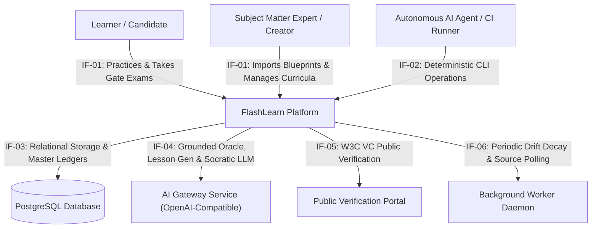

# 3. Context and Scope

> [!INFO] **Architecture Provenance & Freshness**
> - **Verified Commit**: `d680042` (branch: `main`)
> - **Verified Timestamp**: `2026-11-24T13:26:03Z`
> - **Tracked Paths**: `apps/`, `packages/`, `scripts/`
> - **Drift Status**: `verified`

This section defines the external boundaries of the FlashLearn platform, identifying interacting human users, autonomous agents, and upstream/downstream external systems.

---

## 3.1 Business Context (C4 Context Diagram)

---

## 3.2 Technical Context & Interface Matrix

| Interface ID | Partner | Protocol / Format | What Goes In (Input) | What Goes Out (Output) |
|---|---|---|---|---|
| IF-01 | Web Browser | HTTP/2, JSON, SSE | User gestures, attempt submissions, Socratic chat messages, JWT/OAuth tokens | Svelte 5 SPA assets, DAG states, learning bundles, SSE chat tokens (`/api/v1/socratic/stream`) |
| IF-02 | Agent CLI (`flashlearn`) | HTTP REST, JSON | CLI commands (`bun run cli` / `flashlearn`), `Authorization: Bearer` / `x-api-key` headers, blueprint JSON | Structured JSON envelopes (`schemaVersion`, `status`, `data`, `nextActions`) and deterministic exit codes |
| IF-03 | PostgreSQL Engine | TCP, PostgreSQL Wire | Drizzle parameterized SQL queries (`db.select()`/`insert`/`update`), advisory-locked migrations | Relational rowsets, transaction commits, connection pool health |
| IF-04 | AI Gateway (Lumis / 9router / OpenAI-compatible) | HTTPS, JSON & SSE | OpenAI-compatible `/chat/completions` payloads (system prompt, multi-turn history, optional `json_object` mode) and `/models` health probes | Structured Oracle Class B / Adversarial JSON verdicts, verified lesson drafts, Socratic responses & SSE streams |
| IF-05 | External Verifiers / HR | HTTPS, JSON / JSON-LD | Public passport grant ID (`/api/v1/gates/verify/:grantId`) or W3C VC 2.0 JSON payload (`/api/v1/credentials/verify`) | Cryptographic Ed25519 verification result, issuer DID metadata, active/revoked status |
| IF-06 | Background Worker Daemon | In-Process Event Loop / CLI `--once` | Periodic 60s tick (embedded in `apps/api/src/index.ts` or standalone `bun run worker`) | Competency drift decay recalculations (`ProcessCompetencyDecayBatchUseCase`), provisional gate suspensions, source health counts |

---

## 3.3 Scope Boundaries: In-Scope vs. Out-of-Scope

### In-Scope
- Active Recall materials, quizzes, 3D flashcards, and SM-2 spaced repetition (`SpacedRepetitionScheduler`).
- Topological prerequisite DAG evaluation with cycle detection and Knowledge Space Theory diagnostic placement (`DiagnosticPlacementEngine`).
- Dual-Loop task execution separating Sandbox practice (with Socratic tutor & unaided checkpoint) from Official Gate Exam (with AI Tutor disabled).
- Domain-agnostic backward scaffolding derivation (`BackwardScaffoldingGenerator`) and DB-backed *Corpus of Record* display (`CorpusReferenceCard`).
- Multi-tier oracle evaluation (Class A deterministic, Class B & Adversarial fail-fast AI judge, Class C double-blind multi-rater Gwet's AC1/AC2 consensus).
- Predictive competency drift modeling (DSR Power Forgetting Curve) and Ed25519-signed W3C Verifiable Credentials 2.0.

### Out-of-Scope
- Direct hosting or transcoding of large video/audio media streams.
- Native mobile binary builds (addressed via responsive Framework7 mobile web UI).
- Proprietary LLM model training or local model weight hosting (FlashLearn connects strictly to external OpenAI-compatible LLM gateways via `IAiGateway`).
