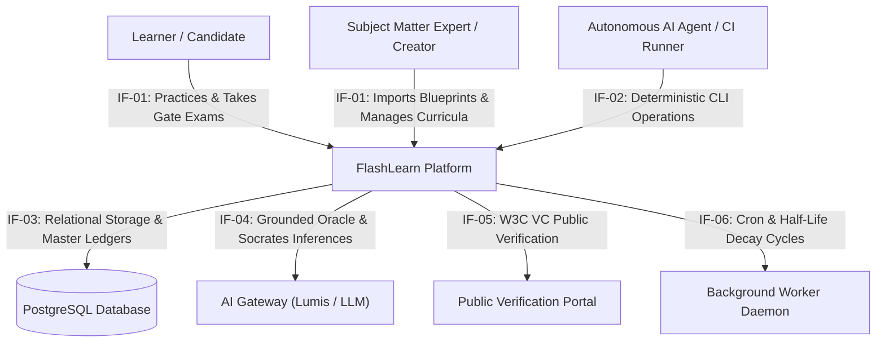

# 3. Context and Scope

> [!INFO] **Architecture Provenance & Freshness**
> - **Verified Commit**: `2757f63` (branch: `main`)
> - **Verified Timestamp**: `2026-10-25T22:34:00+07:00`
> - **Tracked Paths**: `apps/`, `packages/`, `scripts/`
> - **Drift Status**: `verified`

This section defines the external boundaries of the FlashLearn platform, identifying interacting human users, autonomous agents, and upstream/downstream external systems.

---

## 3.1 Business Context (C4 Context Diagram)

The following Mermaid diagram outlines the high-level boundary of the FlashLearn system within its operational ecosystem:

---

## 3.2 Technical Context & Interface Matrix

The external interfaces connecting FlashLearn with external components are detailed below:

| Interface ID | Partner | Protocol / Format | What Goes In (Input) | What Goes Out (Output) |
|---|---|---|---|---|
| IF-01 | Web Browser | HTTP/2, JSON, SSE | User gestures, attempt submissions, chat queries, auth tokens | Svelte 5 SPA markup, reactive DAG states, streaming tokens |
| IF-02 | Agent CLI (`fl`) | HTTP REST, JSON | CLI commands, headless auth headers, domain blueprint JSON | Structured `--json` payloads, deterministic exit codes (0/non-zero) |
| IF-03 | PostgreSQL Engine | TCP, PostgreSQL Wire | SQL parameterized queries, transaction commands, migration scripts | Relational records, query rowsets, connection pool health |
| IF-04 | Lumis / LLM APIs | HTTPS, JSON | Oracle Class B evaluation prompts, grounded corpus context | Structured evaluation verdicts, rubrics, Socratic hints |
| IF-05 | External Verifiers / HR | HTTPS, JSON-LD | Public Passport token or W3C VC credential payload | Cryptographic signature validity, issuer metadata, revoked status |
| IF-06 | System Cron Engine | In-Process Event Loop | Scheduled triggers, tick events, worker execution signals | Skill half-life decay updates, spaced card due notifications |

---

## 3.3 Scope Boundaries: In-Scope vs. Out-of-Scope

### In-Scope
- Active Recall and 3D flashcard generation with spaced repetition scheduling (SM-2 / FSRS).
- Topological prerequisite DAG evaluation with real-time acyclicity and progression calculation.
- Dual-Loop task execution with integrated safe sandbox and authentic Gate verification.
- Automated backward scaffolding derivation for arbitrary domain blueprints.
- Multi-tier oracle evaluation with deterministic mathematical tolerances and AI judge personas.
- Progressive authorization gate passports and W3C Verifiable Credentials issuance.

### Out-of-Scope
- Direct hosting of large multimedia streaming files (video training is offloaded or embedded via URLs).
- Native mobile app binary builds (addressed via responsive mobile PWA / touch targets $\ge 44\text{px}$).
- Proprietary closed-source LLM training (FlashLearn acts purely as an orchestrator and judge via external LLMs).
