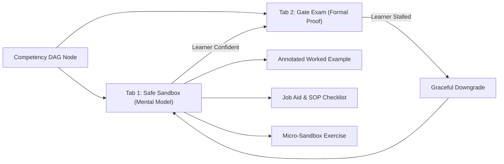

# 4. Solution Strategy

> [!INFO] **Architecture Provenance & Freshness**
> - **Verified Commit**: `1cf9418` (branch: `main`)
> - **Verified Timestamp**: `2026-10-25T20:10:07+07:00`
> - **Tracked Paths**: `apps/`, `packages/`, `scripts/`
> - **Drift Status**: `verified`

The architecture of FlashLearn is fundamentally driven by cognitive psychology (Sweller's Cognitive Load Theory, van Merriënboer's 4C/ID model) and software craftsmanship (Clean Architecture, SOLID, and Zero-Mock assurance).

---

## 4.1 Core Architectural Strategies

### 1. The Dual-Loop Learning Architecture
FlashLearn rejects the "Assessment-as-Instruction Fallacy"—the practice of presenting brief textbook text and immediately confronting the learner with a high-stakes, strict Oracle evaluation.
- Every competency DAG node is structured as a **Dual-Loop Container**:
  - **Loop 1: Safe Training & Mental Model Formation (Tab 1 Sandbox)**:
    Provides operational job aids, annotated worked examples deconstructing expert decisions, and penalty-free micro-sandboxes.
  - **Loop 2: High-Assurance Certification (Tab 2 Gate Exam)**:
    Provides rigorous, unassisted Oracle evaluation. If a candidate stalls, the **Graceful Downgrade Protocol** allows opening step-by-step guidance by automatically switching the attempt into a practice session, preserving credential integrity.

### 2. Universal Cognitive Archetypes
Rather than hardcoding industry-specific logic, FlashLearn models all professional tasks into four universal cognitive archetypes:
1. `algorithmic_quant`: Quantitative tasks requiring mathematical formula evaluation and step-by-step tolerance checking ($\pm 1\%$).
2. `artifact_audit`: Document, code, or telemetry inspection requiring systematic discrepancy detection and compliance checklists.
3. `ill_structured_case`: Multi-stakeholder scenarios requiring nuanced ethical justification and defensive reasoning under executive pressure.
4. `rapid_fluency`: High-speed memory retrieval under strict time limits (3D flashcards and memory items).

### 3. Task-First Backward Scaffolding Generation
To solve the **Authoring Bottleneck**, FlashLearn implements a task-first backward design pattern via `BackwardScaffoldingGenerator`:
- Creators specify only the target exam task (`taskSpec`) and regulatory source chunks (`sourceChunks`).
- The engine automatically derives isomorphic worked examples with varied surface details (different numbers and names) while preserving identical mathematical and legal structures.

### 4. Multi-Tier Oracle Evaluation Architecture
- **Class A (Deterministic)**: Pure mathematical calculation and classification evaluated via deterministic engines.
- **Class B (AI Judge)**: Grounded evaluation of open-ended case studies and document drafts using strictly constrained LLM personas and 100%-weighted rubric criteria.
- **Class C (Human Expert Review)**: Double-blind multi-rater consensus (Gwet's AC1/AC2 coefficient) and manual arbitration for terminal gates.

### 5. Hexagonal / Ports & Adapters Architecture
The core domain model (`Competency`, `Task`, `Attempt`, `Gate`, `Content`, `Source`) depends on zero third-party frameworks. All external dependencies (database access, LLM APIs, cryptography, token generation) are abstracted behind strict domain ports (`ICompetencyRepository`, `ITaskRepository`, etc.) and injected via a unified dependency injection container (`BaseContainer` / `Container`).
