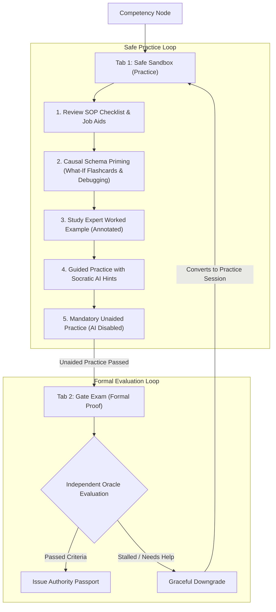

# 4. Solution Strategy

> [!INFO] **Architecture Provenance & Freshness**
> - **Verified Commit**: `d127ab9` (branch: `main`)
> - **Verified Timestamp**: `2026-10-25T21:55:00+07:00`
> - **Tracked Paths**: `apps/`, `packages/`, `scripts/`
> - **Drift Status**: `verified`

The solution strategy of FlashLearn is engineered to achieve one concrete outcome: **ensuring that a learner who completes a module can be safely trusted with real operational responsibility on the job, executing tasks correctly, accurately, and without relying on AI crutches or guesswork.**

Rather than presenting reading materials followed by multiple-choice tests, the platform is structured as an interactive flight simulator for workplace responsibilities. Below are the seven core strategies, accompanied by an explicit analysis of their trade-offs, weaknesses, and failure modes.

---

## 4.1 Core Architectural Strategies

### 1. Dual-Loop Learning: Safe Practice Sandbox vs. Independent Gate Exam

Every competency node in the curriculum separates the learning environment into two strictly demarcated spaces:
- **Loop 1: Safe Practice Sandbox (Mental Model & Skill Building)**
  A zero-penalty environment where learners build procedural instincts. It provides operational tools (SOP checklists, statutory citations, calculation formulas), causal priming flashcards, step-by-step expert worked examples showing how a real case is solved, and an interactive sandbox with immediate sub-step error checking.
- **Loop 2: High-Stakes Gate Exam (Proof of Independent Capability)**
  An unassisted evaluation where the learner must solve an authentic operational scenario independently. Passing this gate is the requirement to unlock subsequent responsibilities and receive authority credentials.
- **Causal Schema Priming (Causal Flashcards & Quizzes)**:
  Before learners enter the full interactive simulator, they pass through a mental model priming stage. Flashcards are not used for memorizing word definitions; instead, they act as **Causal Probes ("What-If" prediction cards)** and **Micro-Debugging Quizzes** to instill the underlying cause-and-effect mechanics of the domain before facing complex multi-variable tasks.
- **The "AI Crutch Guardrail" (Mandatory Unaided Practice)**:
  Recent empirical studies (e.g., *Bastani et al., 2025*) show that unguided AI assistance during practice inflates immediate performance but drops independent exam performance by 17% because learners use the AI as a crutch. To prevent this "illusion of competence," FlashLearn enforces an **Unaided Practice Step**: before the Gate Exam tab unlocks, the learner must successfully complete at least one practice scenario with the AI tutor completely disabled.
- **Graceful Downgrade Protocol**:
  If a candidate freezes or stalls during the Gate Exam, they can opt for a Graceful Downgrade. The system converts the exam into a guided practice session, revealing diagnostic hints without recording a permanent failure mark on their official transcript.

#### Weaknesses & Failure Modes
- **Failure Mode 1.1 (Learner Frustration Upon AI Removal)**:
  Learners who rely heavily on AI hints during Step 4 may experience sudden anxiety or freeze when facing Step 5 (Unaided Practice).
  *Mitigation*: Implement gradual hint fading (reducing hint detail from full explanations to simple clause references) before completely turning off the AI.
- **Failure Mode 1.2 (Gaming the Downgrade to Peek at Exam Questions)**:
  A learner might open the Gate Exam just to see the exam questions, immediately trigger Graceful Downgrade, practice those exact questions, and retake the test.
  *Mitigation*: The Gate Exam pulls from a randomized pool of procedurally-generated isomorphic variants. Triggering a downgrade immediately invalidates that specific scenario instance; the next exam attempt presents a fresh scenario with different numbers, vendor names, and discrepancy patterns.

---

### 2. Causal Schema Priming: Redesigning Flashcards & Quizzes for Mental Models

Traditional flashcards that test definition recall (*"What is the definition of Kraljic Matrix?"*) fail to produce operational capability (*Lohse & Healy, 2012*). FlashLearn re-engineers flashcards and micro-quizzes into active causal diagnostic probes based on the Mental Model Matrix (*Borders et al., 2024*):
1. **Causal Prediction Flashcards ("What-If" Probes)**:
   Tests cause-and-effect directionality. The learner is presented with an operational scenario change (e.g., *"If salvage value in Year 5 increases by 20%, does the total Net Present Value of procurement cost increase, decrease, or remain unchanged?"*). The system enforces **Active Prediction Before Flip**: the learner must select an impact direction before revealing the expert causal rationale.
2. **Analogical Comparison Quizzes (Deep Structure Alignment)**:
   Presents two scenarios from completely different surface industries side-by-side (e.g., IT Server Hosting vs. Hospital Reagent Contracts). The learner must identify which cost component in Case B functionally corresponds to the Annual Maintenance License in Case A (*Gick & Holyoak, 1983*), training the mind to spot deep underlying structures rather than superficial surface details.
3. **Micro-Debugging Quizzes (Error Detection)**:
   Presents a completed operational worksheet containing one deliberate regulatory or mathematical discrepancy (e.g., invoice date preceding purchase order date). The learner must spot the defect within 60 seconds (*Sun et al., 2024, effect size g = 0.64*), building an early warning radar for real-world auditing.

#### Weaknesses & Failure Modes
- **Failure Mode 2.1 (Over-Simplification vs. Integrated Reality)**:
  A learner may master isolated "What-If" cards easily but freeze when navigating the full interactive simulator where multiple variables move simultaneously.
  *Mitigation*: Causal Flashcards are strictly prerequisite priming; the system prohibits skipping straight from flashcards to the Gate Exam without completing the integrated sandbox simulation.
- **Failure Mode 2.2 (Fluency Illusion on Flip)**:
  Learners may flip cards passively and falsely believe they understood the reasoning (*"Oh, I already knew that"*).
  *Mitigation*: The UI locks the answer reveal until an explicit choice or typed prediction is submitted.

---

### 3. Adaptive Fading Scaffolding (Gradual Removal of Support)

Novices cannot handle a completely blank canvas on complex operational tasks, but static templates fail to develop independent capability (*Salden et al., 2010*). FlashLearn applies an adaptive fading gradient:
1. **Full Expert Example**: 100% completed by an expert, fully annotated with decision rationales and common error traps.
2. **High-Scaffolding Task**: 70% of the worksheet or calculation is pre-filled. The learner only executes the final critical decision checkpoints (e.g., calculating the final NPV comparison).
3. **Low-Scaffolding Task**: 30% pre-filled (basic structure provided, all intermediate calculations required).
4. **Zero-Scaffolding Task**: Blank operational template requiring end-to-end execution from raw scenario data.

Fading is **adaptive**: if a learner completes a high-scaffolding task without any sub-step error, the system fast-tracks them directly to zero-scaffolding. If they struggle, the system keeps supportive scaffolding active.

#### Weaknesses & Failure Modes
- **Failure Mode 3.1 (Superficial Pattern Matching)**:
  In partially pre-filled tasks, learners may guess answers by mechanically copying patterns from adjacent rows without understanding the underlying regulation or mathematical logic.
  *Mitigation*: Diagnostic checkpoints require explicit citations (e.g., selecting the specific regulatory article or audit standard that justifies the entered number).
- **Failure Mode 3.2 (Scaffolding Miscalibration)**:
  If the system misjudges learner readiness and removes scaffolding too early, the learner experiences cognitive overload and failure; if it fades too slowly, advanced learners get bored (*Expertise Reversal Effect*).
  *Mitigation*: Real-time latency and error tracking per sub-step. Two consecutive sub-step errors automatically restore intermediate helper tooltips.

---

### 4. Multi-Observation Entrustment (Preventing Fluke Passes)

In medical and high-stakes workplace training (*Ryan et al., 2024; Mazzone et al., 2020*), a single successful performance on an exam has poor psychometric generalizability—a candidate can pass through luck, guessing, or memorizing one specific question.
- For introductory knowledge, a single passing attempt suffices.
- For **Level 2 (Senior Operational Authority)** and **Level 3 (Terminal Authority)**, the system enforces a **Multi-Observation Protocol**:
  The candidate must pass **at least two distinct isomorphic scenario variants** (identical procedural difficulty and regulatory constraints, but completely different data and edge cases) before authority credentials are issued.

#### Weaknesses & Failure Modes
- **Failure Mode 4.1 (Assessment Fatigue and Dropout)**:
  Requiring multiple full-length scenarios increases time investment, which can lead to high abandonment rates among busy working professionals.
  *Mitigation*: Keep scenarios tightly focused and modular (< 15 minutes per scenario), evaluating core decision steps rather than repetitive data entry.
- **Failure Mode 4.2 (Variant Difficulty Imbalance)**:
  If Variant B happens to be significantly harder or contains an ambiguous edge case not present in Variant A, learners perceive the system as unfair.
  *Mitigation*: Automated backward derivation checks ensure all generated variants share identical mathematical properties, tolerance bands, and clause counts.

---

### 5. Multi-Tier Verification Oracles (Separation of Evaluation Engines)

To prevent evaluation bias and hallucination, FlashLearn splits assessment into three isolated engines:
- **Oracle Class A (Deterministic Engine)**:
  Used for exact calculations, financial models, and rule-based classifications. Runs local TypeScript/Rust code without LLMs. Enforces strict mathematical tolerance bands ($\le \pm 1\%$).
- **Oracle Class B (Corpus-Grounded AI Judge)**:
  Used for qualitative evaluations (drafting contract clauses, explaining compliance decisions). Uses strict prompt rubrics and evaluates exclusively against cited passages from the *Corpus of Record*. Prohibits open-ended conversational leeway.
- **Oracle Class C (Human Expert Panel)**:
  Used for terminal authority sign-offs and edge-case disputes. Supported by multi-rater consensus scoring.

#### Weaknesses & Failure Modes
- **Failure Mode 5.1 (Class A False Negatives on Valid Alternative Methods)**:
  A candidate uses a legally valid alternative accounting method or rounding sequence that arrives at a slightly different number, causing the deterministic script to flag it as wrong.
  *Mitigation*: Break multi-step calculations into modular sub-step inputs (Capex, Opex Present Value, Salvage Present Value) with configurable tolerance bands ($\pm 1\%$) rather than evaluating only the final grand total.
- **Failure Mode 5.2 (Class B AI Judge Leniency or Sycophancy)**:
  An LLM evaluator might be swayed by eloquent, professional-sounding language and grant a passing grade to an answer that contains subtle regulatory violations.
  *Mitigation*: Dual-agent judge architecture (Judge Agent proposes score, Adversarial Critic Agent actively searches for missing regulatory requirements). The evaluation fails if mandatory factual assertions are absent from cited chunks.
- **Failure Mode 5.3 (Class C Operational Bottleneck)**:
  Requiring human expert review creates scheduling delays, destroying the 24/7 self-directed learning experience.
  *Mitigation*: Restrict Class C exclusively to terminal high-stakes delegations. All intermediate competencies rely 100% on Class A and automated Class B oracles.

---

### 6. Empirical Skill Half-Life Decay & Proactive Refreshers

Traditional certifications treat competence as permanent ("pass once, certified forever"). Meta-analyses on procedural skill retention (*Tatel & Ackerman, 2025*) reveal that **50% of procedural accuracy gains are lost after ~6.5 months** of non-use.
- FlashLearn models procedural competence decay using the **Tatel-Ackerman 6.5-Month Half-Life parameter**.
- The system automatically schedules lightweight retrieval refreshers at 30 days, 90 days, and 180 days post-certification.
- A refresher consists of a single 3-minute micro-simulation of an edge case, maintaining operational reflexes without requiring the learner to retake the full course.

#### Weaknesses & Failure Modes
- **Failure Mode 6.1 (Notification Fatigue & User Resentment)**:
  Certified professionals dislike being told their credentials have "expired" or being nagged by automated emails to re-test.
  *Mitigation*: Frame refreshers as "Operational Flight Drills" rather than tests. Completing a 3-minute drill extends passport validity by 6 months.
- **Failure Mode 6.2 (False Decay for Active Practitioners)**:
  An officer who performs procurement daily in their real job will be flagged as "decayed" in the system simply because they have not logged into FlashLearn for 6 months.
  *Mitigation*: Provide an organizational attestation endpoint where department managers can verify active on-the-job practice, resetting the decay timer without mandatory app logins.

---

### 7. Zero Domain Hardcoding: Autonomous Coding Agent CLI Generation Pipeline

The core application codebase (`apps/api`, `apps/web`, `packages/shared`) contains **zero hardcoded domain business rules, zero procurement-only logic, and zero hardcoded statutory clauses**.
- FlashLearn is a purely domain-agnostic competency engine.
- All domain-specific curriculum content—including:
  1. Ingestion and semantic chunking of authoritative regulatory corpora (*Corpus of Record*),
  2. Construction of competency DAG nodes and prerequisite dependency edges,
  3. Generation of Causal Prediction Flashcards and Analogical Comparison Quizzes,
  4. Authoring of isomorphic Annotated Worked Examples and Adaptive Scaffolding templates,
  5. Specification of Multi-Tier Oracle verification rules and test datasets—
  **must be completely generated, validated, and ingested by an autonomous Coding Agent through the Headless CLI** (`packages/cli`, executed via `bun run cli domain import / generate / certify`).
- Before any generated domain blueprint is persisted into the production database, it must pass a strict automated certification gauntlet:
  - **DAG Acyclicity Audit**: Verifies zero cyclic prerequisite deadlocks using Tarjan's Strongly Connected Components algorithm ($O(V + E)$).
  - **Corpus Citation Completeness**: Every question, checkpoint, and rubric criterion must cryptographically map to an existing SHA-256 chunk hash.
  - **Oracle Solvability Proof**: Programmatic test runners verify that every generated quantitative scenario has an exact, non-ambiguous mathematical solution within $\le \pm 1\%$ tolerance.

#### Weaknesses & Failure Modes
- **Failure Mode 7.1 (AI Hallucination in Regulatory Chunks / Synthetic Passages)**:
  A coding agent generating curriculum for a novel domain might fabricate plausible-sounding statutory articles or regulatory numbers that do not exist in real law.
  *Mitigation*: Source documents must be provided as raw verbatim text files; the CLI chunking tool computes cryptographic SHA-256 digests on raw input files before any AI processing. Generated tasks that reference non-existent chunk hashes are rejected by the database schema constraint (`FOREIGN KEY` to `source_chunks`).
- **Failure Mode 7.2 (Mathematical or Financial Inconsistencies in Generated Tasks)**:
  An LLM generating dynamic financial models might generate conflicting numbers (e.g., negative salvage value or discount rates that cause division by zero).
  *Mitigation*: The CLI certification gauntlet runs an automated AST validator that executes the oracle solver against the generated parameters. If the solver detects an unsolvable equation or undefined result, the blueprint generation fails immediately.
- **Failure Mode 7.3 (Schema Drift Between CLI Generator and Database Migrations)**:
  If the API database schema evolves (e.g., adding mandatory columns to `competencies`), CLI generation scripts may produce outdated JSON formats.
  *Mitigation*: The monorepo uses shared TypeScript types (`packages/shared/src/schema/`) across the API, CLI, and validation scripts, enforcing compile-time type safety (`bun run build`).
