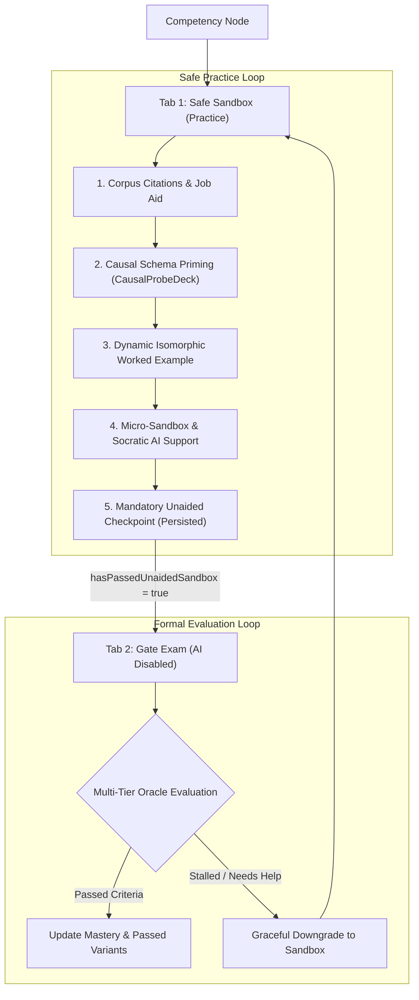

# 4. Solution Strategy

> [!INFO] **Architecture Provenance & Freshness**
> - **Verified Commit**: `3f27daa` (branch: `main`)
> - **Verified Timestamp**: `2026-11-22T14:10:12+07:00`
> - **Tracked Paths**: `apps/`, `packages/`, `scripts/`
> - **Drift Status**: `verified`

FlashLearn's solution strategy is engineered around one concrete outcome: **verifying that a learner can execute real-world operational responsibilities accurately and independently before granting authority credentials.**

Each strategy below distinguishes clearly between **currently implemented mechanisms** and **planned evolutions** tracked in Section 11 (`DEBT-xx`).

---

## 4.1 Core Architectural Strategies

### 1. Dual-Loop Learning: Safe Practice Sandbox vs. Unaided Gate Exam
- **Loop 1: Safe Practice Sandbox (`LearningSandboxTab.svelte`)**
  Provides DB-grounded *Corpus of Record* citations, causal priming probes (`CausalProbeDeck.svelte`), dynamically derived isomorphic worked examples, micro-sandbox checkpoints, and optional Socratic AI tutoring. Practice submissions (`isPractice: true`) are recorded without granting official mastery.
- **Anti-AI-Crutch Guardrail (Mandatory Unaided Checkpoint)**
  Motivated by *Bastani et al. (2025)* showing that unguided AI assistance degrades independent exam performance, Tab 2 (`GateExamTab.svelte`) stays locked until `hasPassedUnaidedSandbox` is recorded (persisted via `POST /api/v1/competencies/:id/unaided-sandbox-pass` or an unaided passing practice attempt via `POST /api/v1/tasks/:id/submit`). Inside `GateExamTab.svelte`, `TaskExecutionForm` sets `disableAiTutor={true}` to disable the Socratic AI Tutor during official exams.
- **Graceful Downgrade Protocol**
  If a candidate stalls inside the Gate Exam, a confirmation modal allows switching cleanly back to Tab 1 (`LearningSandboxTab.svelte`) without recording an official failure. *(Planned evolution in `DEBT-03`: automatic instance burning and randomized isomorphic variant reassignment upon downgrade.)*

---

### 2. Causal Schema Priming (Mental Model Activation)
Instead of passive definition recall, `spaced_flashcards` supports typed cognitive probes (`card_type`: `definition`, `causal_prediction`, `analogical_comparison`, `micro_debugging`) with `prediction_options` and `causal_rationale`, surfaced directly in `GetCompetencyLearningBundleUseCase` and rendered by `CausalProbeDeck.svelte`:
- **Active Prediction Before Reveal**: Learners select a prediction hypothesis before revealing the causal rationale.
- **Analogical & Micro-Debugging Views**: Side-by-side Scenario A/B panels and faulty code/artifact snippet boxes render when supplied by the probe payload. *(Planned enhancement: timed 60-second micro-debugging drills.)*

---

### 3. Domain-Agnostic Backward Scaffolding
To eliminate the SME authoring bottleneck without hardcoding any domain logic, `BackwardScaffoldingGenerator` (`apps/api/src/application/services/BackwardScaffoldingGenerator.ts`) derives scaffolding dynamically from each competency's `cognitiveArchetype` (`algorithmic_quant`, `artifact_audit`, `ill_structured_case`, `rapid_fluency`), `task.oracleData` (`formula`, scaled `variables`, `checklist`, `mandatory_citations`), `task.adversarialSpec`, and linked *Corpus of Record* citations.
- *Planned evolution (`DEBT-03`)*: 4-tier adaptive fading (70% -> 30% -> 0% pre-filled worksheets driven by real-time sub-step latency and error streaks).

---

### 4. Multi-Observation Entrustment (Preventing Fluke Passes)
To prevent single-attempt lucky passes on high-stakes authorities:
- Tasks declare `scenario_variant_code` (e.g., `variant_a`, `variant_b`) and `is_isomorphic_variant`.
- On passing an official attempt, `EvaluateAttemptUseCase` appends the task's `scenarioVariantCode` into `mastery_records.passed_variant_codes`.
- `GateAuthorizationEngine.evaluateEligibility()` enforces `gate_requirements.required_observations_count`: when a requirement demands $\ge 2$ observations, eligibility is denied until the learner passes at least that many distinct isomorphic scenario variants.

---

### 5. Multi-Tier Verification Oracles with Fail-Fast LLM Boundary
Assessment is partitioned into isolated engines running purely in TypeScript/Bun (zero Rust components):
- **Oracle Class A (`OracleEvaluatorClassA`)**: Deterministic numerical and checklist evaluator enforcing $\pm 1\%$ default relative tolerance (`expectedFormulas` or seed `variables` targets + `requiredChecklistItems`/`checklist`). Fails fast with `ORACLE_CLASS_A_MISCONFIGURED` if no verifiable criteria exist—never auto-passing 100%.
- **Oracle Class B (`OracleEvaluatorClassB`) & Adversarial (`OracleEvaluatorAdversarial`)**: Grounded LLM judges communicating via `IAiGateway` (`AiGatewayService`) with RCAF structured JSON rubrics, negative-anchor trap penalties, and TSI/BDS/RSS veto rules. **Strict Fail-Fast**: if the AI Gateway is unconfigured, times out, or returns upstream errors, the evaluator throws `AI_EVALUATOR_UNAVAILABLE` (HTTP 503) rather than silently awarding a passing score. *(Planned evolution in `DEBT-03`: dual-agent Judge + Adversarial Critic debate pipeline.)*
- **Oracle Class C (`MultiRaterConsensusEngine`)**: Double-blind human expert adjudication computing observed agreement ($P_o$), Cohen's Kappa, Gwet's AC1, and quadratic-weighted Gwet's AC2, escalating divergent scorecards to a Chief Arbiter.

---

### 6. Predictive Competency Drift & Embedded Decay Worker
To counter procedural skill decay (motivated by *Tatel & Ackerman, 2025*), FlashLearn models competency retrievability using a **DSR Power Forgetting Curve** (`CompetencyDriftEngine`):
$$R(t) = \left(1 + \frac{0.19 \cdot t}{S}\right)^{-0.5}$$
- Default stability $S = 30.0$ days, warning threshold $R < 0.85$ (`drift_warning`), provisional expiration $R < 0.70$ (`provisionally_expired`).
- `BackgroundWorkerDaemon` (`apps/api/src/worker.ts`, embedded in `index.ts` or runnable standalone via `bun run worker`) runs `ProcessCompetencyDecayBatchUseCase` every 60 seconds, marking expired masteries `stale` and suspending dependent active gate grants to `provisional`.
- `RevalidateCompetencyChallengeUseCase` stretches stability $S$ on passing micro-revalidation challenges (desirable difficulty) and collapses $S$ on failure. *(Planned enhancement: organizational on-the-job attestation endpoint.)*

---

### 7. Domain-Agnostic Core & Declarative Blueprint CLI Pipeline
Core runtime code (`apps/api/src/domain/`, `apps/api/src/application/`, `apps/web/src/`, `packages/shared/src/`) contains **zero hardcoded domain statutes or procurement-only widgets**:
- `CorpusReferenceCard.svelte` renders actual `source_chunks` fetched from PostgreSQL for whatever domain is open.
- Autonomous Coding Agents synthesize, validate, and ingest arbitrary domains via the Headless CLI (`bun run cli` / `flashlearn`):
  - `flashlearn domain validate-blueprint --file <blueprint.json>` (or `domain synthesize`): runs `validateDomainBlueprint` + Tarjan SCC acyclicity (`packages/shared/src/utils/graph-validator.ts`) + 100%-weighted rubric validation.
  - `flashlearn domain import-blueprint --file <blueprint.json> [--dry-run]`: declaratively imports workspace, SHA-256 hashed source chunks, competency DAG, gates, and tasks.
  - `flashlearn domain describe <id-or-slug>`: audits domain completeness, orphan competencies, cycle integrity, and readiness score.
- Five canonical starter domain seeds live strictly isolated in `apps/api/src/infrastructure/database/seeds/` for turnkey container onboarding (`DEBT-06`).
- Shared contract types reside in `packages/shared/src/types/` and shared validators in `packages/shared/src/utils/`, verified at compile time via `tsc --noEmit`.

---

### 8. Bridging Analogies (Clement & Brown), Guided Single-Focus UX & Sandboxed Visual Decks
To eliminate passive, shallow text modules without overwhelming learners:
- **Grounding Strategy Router (`InteractiveModulePayload`, `packages/shared/src/types/interactive.ts`)**: Every `interactive_module` explicitly declares a `groundingDecision.mode` based on prior anchor availability, setup cost (`<= 60s`), and scale/dimensionality:
  - `experiential_anchor_bridge`: Launches an instant interactive **Anchoring Micro-Lab** (`StateMachineLab`, `MechanismManipulatorLab`, `WaveFieldTapperLab`, `BridgeMorphLab`, or sandboxed HTML micro-sim) before structural `bridgingChain` mapping and mandatory `analogyBreakpoint`.
  - `direct_analogy`: Uses familiar daily anchors with mandatory `analogyBreakpoint`.
  - `thought_experiment`: Handles high-scale/dimensional concepts (e.g., Byzantine consensus) via progressive thought experiments.
  - `direct_formalism`: Skips contrived analogies when direct formal rules are faster to learn.
- **One-Instruction-Per-Screen Guided Flow (`buildGuidedLearningSteps` -> `InteractiveModuleViewer.svelte`)**: Learners select a topic and follow one clear action at a time (read -> interact -> answer `<1ms` 5-axis diagnostic probe with 1-hint-at-a-time scaffolding), while secondary glossary and PDF source citations stay quietly collapsed until tapped.
- **Seamless Auto-Resume (`learner_content_progress` + `x-learner-session`)**: Step position, slide index, anchoring completion, and diagnostic mastery auto-save to both local storage and PostgreSQL for authenticated AND guest learners, surfaced as one-tap "Lanjutkan Belajar" cards (`ResumeLearningStrip.svelte`).
- **Adaptive Portrait & Landscape HTML Deck Stage (`AdaptiveDeckStage.svelte`)**: Lazy-loaded from `content_artifacts` and rendered strictly inside `<iframe sandbox="allow-scripts">` (without `allow-same-origin`) via FlashLearn's generic MIT `buildSandboxedDeckHtml` bridge (`localStorage` in-memory shim + `postMessage` sync + automatic mobile `low-power` mode). External authoring tools (such as `guizang-ppt-skill` under AGPL-3.0) remain strictly decoupled at CLI authoring time (`flashlearn content import-interactive` / `domain import-curriculum`).
