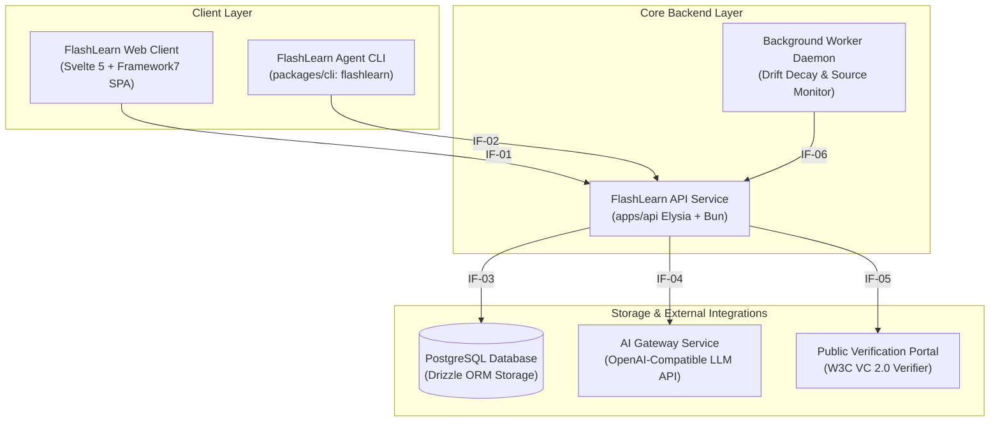

# 5. Building Block View

> [!INFO] **Architecture Provenance & Freshness**
> - **Verified Commit**: `3f27daa` (branch: `main`)
> - **Verified Timestamp**: `2026-11-22T14:10:12+07:00`
> - **Tracked Paths**: `apps/`, `packages/`, `scripts/`
> - **Drift Status**: `verified`

The Building Block View provides the static hierarchical decomposition of FlashLearn into Level-1 containers and Level-2 Hexagonal components.

---

## 5.1 Level 1: System Decomposition (C4 Container Diagram)



---

## 5.2 Level 1 Building Block Specification

| Component | Responsibility | Interfaces |
|---|---|---|
| FlashLearn Web Client | Reactive SPA built with Svelte 5 Runes and Framework7 v9.1.3 (`apps/web`). Renders simple topic pickers & "Lanjutkan Belajar" resume strip (`ResumeLearningStrip.svelte`), Guided Bridging Interactive Modules (`InteractiveModuleViewer.svelte`, `AdaptiveDeckStage.svelte`, native 2-tier Anchoring Micro-Labs, `<1ms` `DiagnosticStressTestCard.svelte`), Competency DAG (`CompetencyDagView.svelte`), Dual-Loop container (`TaskRunnerModal.svelte`, `LearningSandboxTab.svelte`, `GateExamTab.svelte`), `CausalProbeDeck.svelte`, DB-backed `CorpusReferenceCard.svelte`, XSS-safe `MarkdownRenderer.svelte`, and Socratic AI drawer (`LumisChatAssistant.svelte`). | IF-01 |
| FlashLearn API Service | Core Hexagonal backend running on Bun 1.4.2 and Elysia.js (`apps/api`). Hosts domain entities, use cases (including `UpsertContentArtifactUseCase`, `GetContentArtifactUseCase`, `SaveLearnerProgressUseCase`, `GetLearnerProgressUseCase`), `BackwardScaffoldingGenerator`, Multi-Tier Oracles, `CompetencyDriftEngine`, `W3cCredentialCryptoEngine`, `AiGatewayService`, SSE streaming endpoints, and static SPA hosting. | IF-01, IF-02, IF-03, IF-04, IF-05, IF-06 |
| PostgreSQL Database | Relational storage engine managing workspaces, domains, sources, SHA-256 `source_chunks`, contents (including `interactive_payload`), lazy-loaded SHA-256 `content_artifacts`, resumable `learner_content_progress`, competencies, DAG edges, tasks, attempts, mastery records, spaced flashcards, Socratic Merkle sessions, blind reviews, and issued W3C credentials with compound unique constraints. | IF-03 |
| AI Gateway Service | External OpenAI-compatible LLM proxy (9router, Lumis AI Gateway, OpenRouter, or OpenAI) consumed via `AiGatewayService` (`POST /chat/completions` JSON/SSE, `GET /models` health check) with 45s timeout and retry backoff. | IF-04 |
| FlashLearn Agent CLI | Non-interactive CLI (`flashlearn`, invoked via `bun run cli`) providing JSON envelopes, `--fields`/`--tail`/`--filter` token optimization, `--dry-run`, schema introspection, and blueprint validation/import for AI agents and CI pipelines. | IF-02 |
| Public Verification Portal | Public unauthenticated route (`/#/verify/:id`, `apps/web/src/pages/verify-passport.svelte`) paired with `/api/v1/gates/verify/:grantId` and `/api/v1/credentials/verify` for verifying authority passports and Ed25519 W3C VC 2.0 signatures. | IF-05 |
| Background Worker Daemon | Periodic scheduler (`apps/api/src/worker.ts`) embedded in `index.ts` (or runnable standalone via `bun run worker` / `--once`) executing `ProcessCompetencyDecayBatchUseCase` and workspace source monitoring every 60 seconds. | IF-06 |

---

## 5.3 Level 2: Hexagonal Architecture Decomposition (`apps/api` & `packages/shared`)

```text
apps/api/src/
├── index.ts                        # Elysia HTTP server, /health, /api/v1/health/ai, static SPA, embedded worker start
├── worker.ts                       # BackgroundWorkerDaemon (drift batch decay & workspace source checks)
├── domain/                         # Pure Business Logic (Zero HTTP/ORM Framework Dependencies)
│   ├── entities/                   # ApiKey, Attempt, AuditLog, Competency, Content, DiagnosticSession,
│   │                               # DomainEntity, Gate, MasteryRecord, Source, SourceChunk,
│   │                               # SpacedFlashcard, Task, TaskAttemptReview, User, UserGateGrant, Workspace
│   ├── ports/                      # 21 Port Interfaces (IAiGateway, IInteractiveRepository, ICompetencyRepository,
│   │                               # IMasteryRepository, ITaskRepository, IGateRepository, ICredentialRepository, etc.)
│   └── services/                   # CompetencyDriftEngine, CompetencyGraphEngine, FlashcardGeneratorService,
│                                   # GateAuthorizationEngine, KnowledgeSpaceEngine, MultiRaterConsensusEngine,
│                                   # OracleEvaluatorAdversarial, OracleEvaluatorClassA, OracleEvaluatorClassB,
│                                   # SpacedRepetitionScheduler (SM-2), W3cCredentialCryptoEngine (Ed25519)
├── application/                    # Application Use Cases & Orchestration Services
│   ├── engines/                    # DiagnosticPlacementEngine (Knowledge Space Theory)
│   ├── services/                   # BackwardScaffoldingGenerator (Domain-Agnostic Scaffolding Engine)
│   └── use-cases/                  # apikey, audit, auth, competency, consensus, content, credentials,
│                                   # diagnostic, drift, gate, interactive, source, spaced, staleness, task, workspace
└── infrastructure/                 # Concrete Adapters, Frameworks, and I/O
    ├── database/                   # db.ts, migrate.ts (advisory lock), schema.ts, schemas/*, seed.ts, seeds/*
    ├── repositories/               # 18 Drizzle*Repository implementations (explicit db.select() SQL builders)
    ├── services/                   # AiGatewayService, CitationValidatorService, GoogleAuthVerifier, JwtTokenService
    ├── http/                       # 19 Elysia controllers + middlewares/auth.ts (Bearer JWT/API Key + x-learner-session)
    └── di/                         # base.container.ts & container.ts (Central Constructor DI)

packages/shared/src/
├── types/                          # Shared DTOs & domain types (interactive, competency, task, gate, vc, workspace, etc.)
└── utils/                          # blueprint-validator.ts, graph-validator.ts (Tarjan SCC), merkle-transcript.ts,
                                    # interactive-module-validator.ts, guided-flow-builder.ts, deck-sandbox-bridge.ts
```
