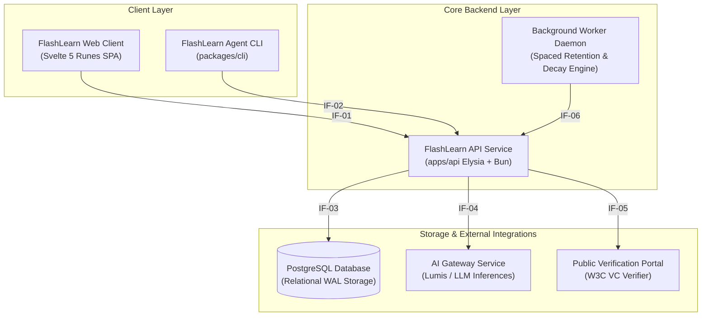

# 5. Building Block View

> [!INFO] **Architecture Provenance & Freshness**
> - **Verified Commit**: `2757f63` (branch: `main`)
> - **Verified Timestamp**: `2026-10-25T22:34:00+07:00`
> - **Tracked Paths**: `apps/`, `packages/`, `scripts/`
> - **Drift Status**: `verified`

The Building Block View provides the static hierarchical decomposition of FlashLearn into Level-1 containers and Level-2 hexagonal components.

---

## 5.1 Level 1: System Decomposition (C4 Container Diagram)



---

## 5.2 Level 1 Building Block Specification

The following table formally defines the Level-1 building blocks, their primary responsibilities, and the interface contracts (`IF-xx`) they expose or consume:

| Component | Responsibility | Interfaces |
|---|---|---|
| FlashLearn Web Client | Reactive user interface built with Svelte 5 Runes (`$state`, `$derived`, `$props`). Renders the Competency DAG (`CompetencyDagView.svelte`), the Dual-Loop modal (`TaskRunnerModal.svelte`, `LearningSandboxTab.svelte`, `GateExamTab.svelte`), 3D Flashcards, and Socratic Tutor drawer. | IF-01 |
| FlashLearn API Service | Core application and domain service running on Bun 1.4.2 and Elysia.js. Implements the Hexagonal architecture containing domain models, use cases, backward scaffolding generator, multi-tier oracles, and crypto engines. | IF-01, IF-02, IF-03, IF-04, IF-05, IF-06 |
| PostgreSQL Database | Relational storage engine managing workspaces, source chunks, competencies, tasks, attempt ledgers, consensus reviews, and cryptographic passport credentials with hard unique constraints and cascade safety. | IF-03 |
| AI Gateway Service | Upstream LLM proxy (Lumis AI Gateway, OpenAI, or OpenRouter) executing grounded Class B Oracle evaluations, rubric scoring, and reflective Socratic guidance without hallucinating answers. | IF-04 |
| FlashLearn Agent CLI | Non-interactive command-line interface (`fl`) providing headless automation, `--json` machine-readable output, dry-run simulations, and curriculum linting for AI coding agents and CI pipelines. | IF-02 |
| Public Verification Portal | Lightweight public verification page (`verify-passport.svelte`) allowing external employers and auditors to verify W3C Verifiable Credentials and Ed25519 digital signatures without logging in. | IF-05 |
| Background Worker Daemon | Asynchronous scheduler executing automated skill half-life decay calculations, SM-2/FSRS retention reviews, and audit trail Merkle root rollups. | IF-06 |

---

## 5.3 Level 2: Hexagonal Architecture Decomposition (`apps/api`)

Inside the `FlashLearn API Service`, components follow strict Hexagonal separation:

```
apps/api/src/
├── domain/                         # Pure Business Logic (Zero Framework Dependencies)
│   ├── entities/                   # Competency, Task, Attempt, Gate, Content, Source
│   ├── ports/                      # Repository and Engine Interfaces (ICompetencyRepository, etc.)
│   └── services/                   # CompetencyGraphEngine, OracleEvaluatorClassA, OracleEvaluatorClassB,
│                                   # GateAuthorizationEngine, W3cCredentialCryptoEngine,
│                                   # MultiRaterConsensusEngine, CompetencyDriftEngine
├── application/                    # Application Use Cases & Scaffolding Services
│   ├── use-cases/                  # Task, Competency, Gate, Source, Drift, Consensus use cases
│   ├── services/                   # BackwardScaffoldingGenerator (Phase 3 Engine)
│   └── engines/                    # DiagnosticPlacementEngine (Knowledge Space Theory)
└── infrastructure/                 # Adapters, Frameworks, and I/O
    ├── database/                   # Drizzle ORM schemas, database connection pool, migrations
    ├── repositories/               # DrizzleCompetencyRepository, DrizzleTaskRepository, etc.
    ├── services/                   # AiGatewayService, GoogleAuthVerifier, JwtTokenService
    ├── http/                       # Elysia HTTP controllers, auth middlewares, validation schemas
    └── di/                         # BaseContainer & Container (Pure Dependency Injection)
```
