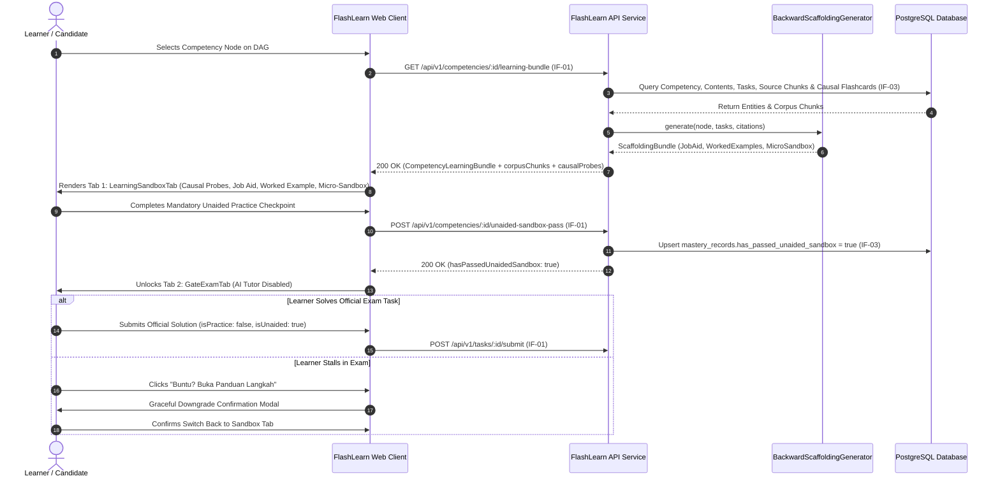
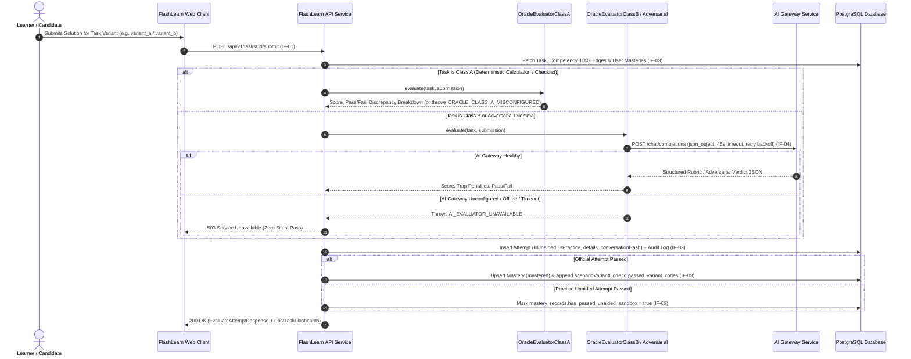
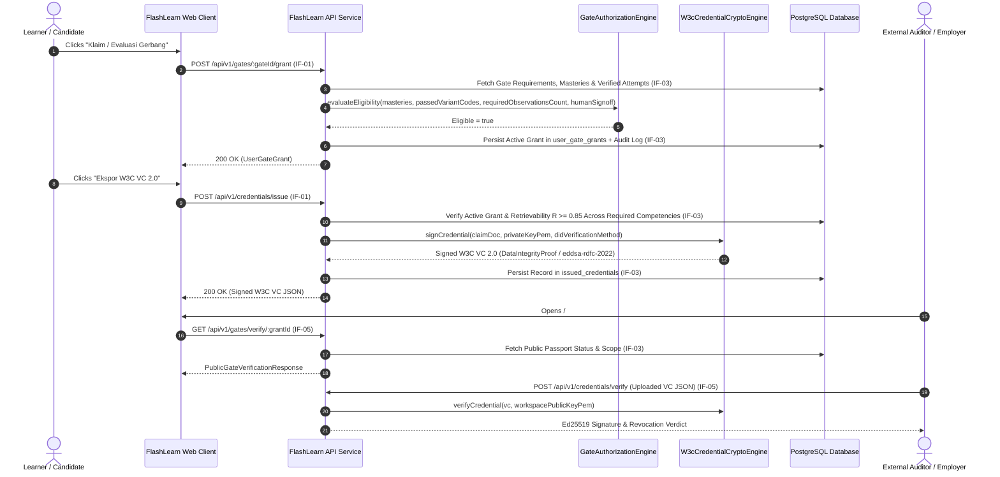

# 6. Runtime View

> [!INFO] **Architecture Provenance & Freshness**
> - **Verified Commit**: `50c1217` (branch: `main`)
> - **Verified Timestamp**: `2026-11-22T11:46:44+07:00`
> - **Tracked Paths**: `apps/`, `packages/`, `scripts/`
> - **Drift Status**: `verified`

The Runtime View describes the dynamic interactions of FlashLearn components across core operational workflows, matching the actual HTTP endpoints and use cases in `apps/api`.

---

## 6.1 Scenario 1: Dual-Loop Competency Learning & Unaided Practice Gate

When a candidate selects a competency node on the DAG, FlashLearn opens `TaskRunnerModal.svelte`:

---

## 6.2 Scenario 2: Multi-Tier Oracle Evaluation, Fail-Fast AI Boundary & Multi-Observation Tracking

---

## 6.3 Scenario 3: Gate Grant, W3C VC 2.0 Issuance & Public Verification

---

## 6.4 Scenario 4: Grounded Socratic AI Chat & SSE Streaming

- **Task-Bound Socratic Guidance**: `POST /api/v1/tasks/:id/socratic-hint` and `POST /api/v1/socratic/turn` execute `AskSocraticTutorUseCase` with real `conversationHistory`, Corpus of Record chunks, and delivered lesson context. `/api/v1/socratic/turn` persists both learner and tutor turns with a chained SHA-256 Merkle root in `socratic_chat_sessions` / `socratic_chat_turns`.
- **Contextual / Streaming Coach**: `POST /api/v1/socratic/chat` (JSON) and `POST /api/v1/socratic/stream` (SSE `text/event-stream` with `X-Accel-Buffering: no`) connect `LumisChatAssistant.svelte` directly to `AiGatewayService` for debriefing, diagnostic coaching, and drift revalidation—failing cleanly with HTTP `503` if the AI Gateway is offline rather than returning fabricated hardcoded responses.
