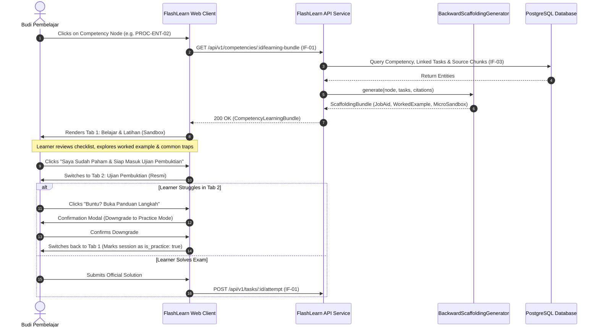
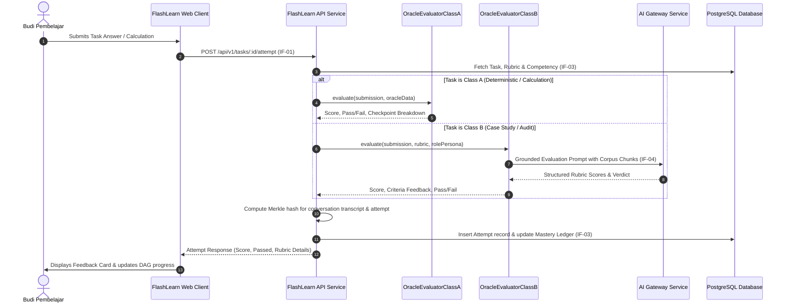
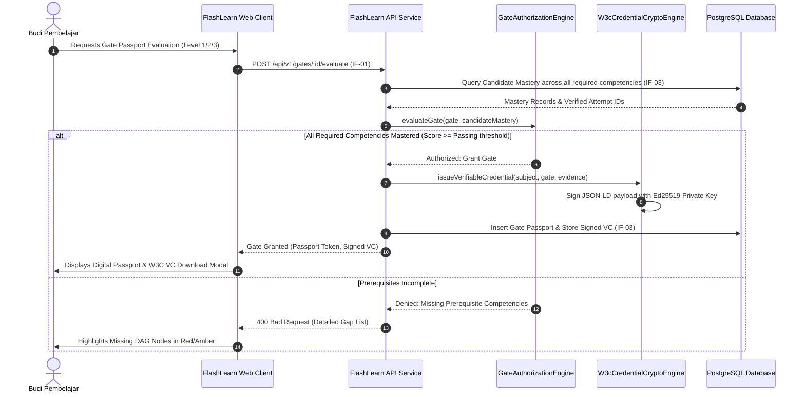

# 6. Runtime View

> [!INFO] **Architecture Provenance & Freshness**
> - **Verified Commit**: `1cf9418` (branch: `main`)
> - **Verified Timestamp**: `2026-10-25T20:10:07+07:00`
> - **Tracked Paths**: `apps/`, `packages/`, `scripts/`
> - **Drift Status**: `verified`

The Runtime View describes the dynamic behavior of FlashLearn components across critical operational scenarios.

---

## 6.1 Scenario 1: Dual-Loop Competency Learning & Graceful Downgrade

When a candidate selects a competency node on the DAG, FlashLearn opens the integrated learning container:

---

## 6.2 Scenario 2: Multi-Tier Oracle Evaluation & Merkle Attempt Hashing

Evaluates candidate submissions and commits an immutable cryptographic audit record:

---

## 6.3 Scenario 3: Progressive Gate Authorization & W3C VC Issuance

Validates prerequisite thresholds and issues cryptographic authority credentials:

