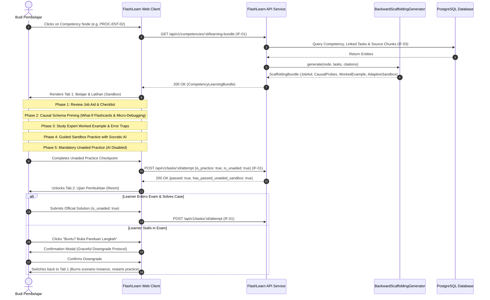
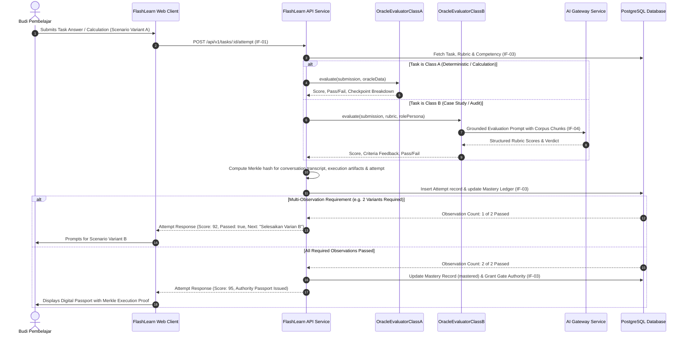
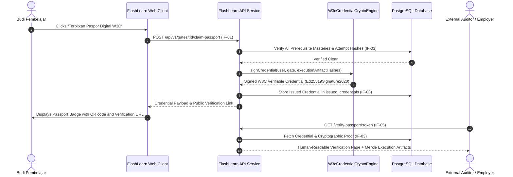

# 6. Runtime View

> [!INFO] **Architecture Provenance & Freshness**
> - **Verified Commit**: `0f9e4c2` (branch: `main`)
> - **Verified Timestamp**: `2026-10-25T22:00:00+07:00`
> - **Tracked Paths**: `apps/`, `packages/`, `scripts/`
> - **Drift Status**: `verified`

The Runtime View describes the dynamic behavior of FlashLearn components across critical operational workflows.

---

## 6.1 Scenario 1: Dual-Loop Competency Learning & Unaided Practice Gate

When a candidate selects a competency node on the DAG, FlashLearn opens the integrated learning container:

---

## 6.2 Scenario 2: Multi-Tier Oracle Evaluation & Multi-Observation Entrustment

Evaluates candidate submissions and verifies multi-observation requirements before granting authority credentials:

---

## 6.3 Scenario 3: Gate Authorization & W3C Verifiable Credential Issuance

When all prerequisite competency gates are mastered, the system issues an Ed25519-signed digital credential encapsulating the Merkle root of the execution artifacts:

