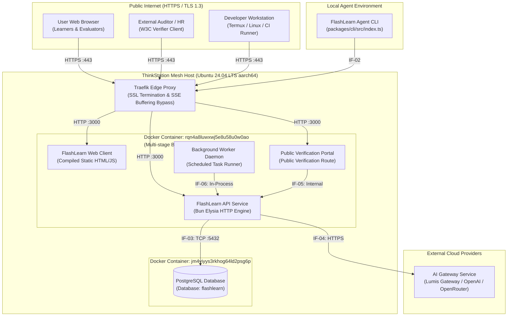

# 7. Deployment View

> [!INFO] **Architecture Provenance & Freshness**
> - **Verified Commit**: `846f709` (branch: `main`)
> - **Verified Timestamp**: `2026-10-26T10:50:00+07:00`
> - **Tracked Paths**: `apps/`, `packages/`, `scripts/`
> - **Drift Status**: `verified`

The Deployment View describes the physical and virtual infrastructure hosting the FlashLearn platform, network boundaries, container topology, and execution environments.

---

## 7.1 Infrastructure & Deployment Topology

---

## 7.2 Building Block Allocation Matrix

The table below maps each Level-1 building block from Section 5 to its concrete runtime deployment target:

| Building Block | Deployment Node / Target | Runtime Technology | Resource Constraints |
|---|---|---|---|
| FlashLearn Web Client | Coolify Application Container (`rqn4a8luwxwj5e8u58u0w0ao`), served statically via Elysia | Static compiled SPA (HTML5, JavaScript, CSS3, SVG) | Zero CPU runtime load; client-side execution in learner browser. |
| FlashLearn API Service | Coolify Application Container (`rqn4a8luwxwj5e8u58u0w0ao`), listening on internal port `3000` | Bun 1.4.2 Linux aarch64 native runtime | Max 256MB RAM ceiling; sub-50ms P95 latency target. |
| PostgreSQL Database | Dedicated Coolify PostgreSQL Container (`jm4yiyys3rkhog64ld2psg6p`), port `5432` | PostgreSQL 16 Alpine, persistent volume mounted | Managed connection pooling (`postgres.js` max 10 connections). |
| AI Gateway Service | ThinkStation Mesh Local Gateway (`https://api.dvlpid.my.id`) or upstream provider | External REST API service over HTTPS | Offloaded CPU load; resilient retry with exponential backoff. |
| FlashLearn Agent CLI | Client workstations, Termux Android containers, or CI/CD runners (`packages/cli`) | Bun CLI executable (`fl` or `bun run ./packages/cli`) | Non-interactive execution; `--json` machine-readable output. |
| Public Verification Portal | Embedded route `/verify-passport` in `FlashLearn Web Client` and public API endpoint | Svelte 5 page with client-side cryptographic verification | Public access without authentication requirements. |
| Background Worker Daemon | Internal background task daemon inside `FlashLearn API Service` | Bun event loop timer and async task runner | Single-threaded lightweight tick execution every 60 seconds. |

---

## 7.3 Infrastructure & Edge Proxy Configuration

1. **Reverse Proxy (Traefik v3)**:
   - Enforces automatic HTTPS via Let's Encrypt certificates for domain `https://learn.dvlpid.my.id`.
   - Disables response buffering (`X-Accel-Buffering=no`) to ensure seamless real-time Server-Sent Events (SSE) streaming for AI tutor tokens.
2. **Container Build Lifecycle**:
   - Automated zero-downtime builds triggered by Coolify webhook or CLI command:
     `agy-ops deploy flashlearn --wait`
   - Multi-stage container compiles TypeScript shared packages and frontend bundles using Vite, discarding build-time tools in the final production layer.
