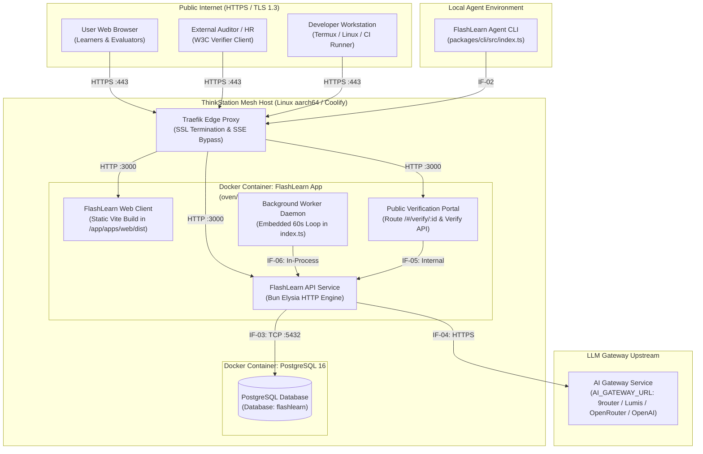

# 7. Deployment View

> [!INFO] **Architecture Provenance & Freshness**
> - **Verified Commit**: `1010f94` (branch: `main`)
> - **Verified Timestamp**: `2026-11-22T11:46:51+07:00`
> - **Tracked Paths**: `apps/`, `packages/`, `scripts/`
> - **Drift Status**: `verified`

The Deployment View describes the physical and virtual infrastructure hosting FlashLearn, container topology, runtime configuration, and deployment lifecycle.

---

## 7.1 Infrastructure & Deployment Topology

---

## 7.2 Building Block Allocation Matrix

| Building Block | Deployment Node / Target | Runtime Technology | Resource & Configuration Notes |
|---|---|---|---|
| FlashLearn Web Client | Coolify App Container (`/app/apps/web/dist`), served statically by Elysia fallback handler in `apps/api/src/index.ts` | Compiled static Vite bundle (Svelte 5 + Framework7 v9.1.3 + KaTeX + highlight.js) | Immutable cache headers for `/assets/*`; zero server-side rendering load. |
| FlashLearn API Service | Coolify App Container, listening on `PORT=3000` (local dev default `3001`) | Bun 1.4.2 (`oven/bun:1.4-alpine`) + Elysia.js 1.4 | Target ceiling 256MB RAM; health check at `GET /health` (`?deep=true` checks AI gateway) and `GET /api/v1/health/ai`. |
| PostgreSQL Database | Dedicated Coolify PostgreSQL Container, TCP port `5432` | PostgreSQL 16 Alpine with persistent volume | Pooled via `postgres.js` (`max: 10`); `DATABASE_URL` mandatory in production (`db.ts` fails fast if unset). |
| AI Gateway Service | External or mesh-hosted OpenAI-compatible gateway configured via `AI_GATEWAY_URL` (default `https://router.dvlpid.my.id/v1`) and `AI_GATEWAY_KEY` | OpenAI-compatible REST & SSE (`/v1/chat/completions`, `/v1/models`) | 45s default timeout (`AI_TIMEOUT_MS`), exponential backoff retries on 429/5xx, strict fail-fast when unconfigured. |
| FlashLearn Agent CLI | Developer workstations, Termux containers, or CI runners (`packages/cli`) | Bun CLI binary `flashlearn` (`bun run cli`) | Non-interactive JSON envelopes, `--dry-run`, `--fields`/`--tail` context optimization. |
| Public Verification Portal | Client SPA route `/#/verify/:id` (`verify-passport.svelte`) + public endpoints `GET /api/v1/gates/verify/:grantId` and `POST /api/v1/credentials/verify` | Svelte 5 + server-assisted Ed25519 verification | Public unauthenticated read/verify access. |
| Background Worker Daemon | Embedded inside `FlashLearn API Service` when `index.ts` runs as main (disable via `DISABLE_EMBEDDED_WORKER=true`), or standalone via `bun run --cwd apps/api worker` / `worker:once` | Bun `setInterval` async loop (`WORKER_INTERVAL_MS`, default `60000`) | Runs `ProcessCompetencyDecayBatchUseCase` and workspace source checks per tick. |

---

## 7.3 Infrastructure & Container Boot Lifecycle

1. **Reverse Proxy (Traefik v3)**:
   - Automatic HTTPS via Let's Encrypt for `https://learn.dvlpid.my.id`.
   - SSE streaming endpoint (`/api/v1/socratic/stream`) emits `X-Accel-Buffering: no` and `Cache-Control: no-cache, no-transform` to bypass proxy buffering.
2. **Container Build & Startup (`Dockerfile` + `start.sh`)**:
   - Multi-stage Docker build (`oven/bun:1.4-alpine`) installs workspace dependencies with `--frozen-lockfile`, builds `apps/web` via Vite, and copies runtime artifacts into the final production stage.
   - On container boot, `start.sh` executes:
     1. `bun run --cwd "$API_DIR" db:migrate` (acquires PostgreSQL advisory lock `84920384`; exits non-zero to halt container startup if migration fails).
     2. `bun run --cwd "$API_DIR" db:seed` (ensures baseline canonical workspaces exist idempotently).
     3. `exec bun "$API_DIR/src/index.ts"` (starts HTTP server, static SPA hosting, and embedded `BackgroundWorkerDaemon`).
3. **Environment Secrets Governance**:
   - Runtime secrets (`DATABASE_URL`, `JWT_SECRET`, `GOOGLE_CLIENT_ID`, `GOOGLE_CLIENT_SECRET`, `AI_GATEWAY_URL`, `AI_GATEWAY_KEY`, optional `SEED_MASTER_API_KEY`) are injected via Coolify / Infisical—never committed into source files.
