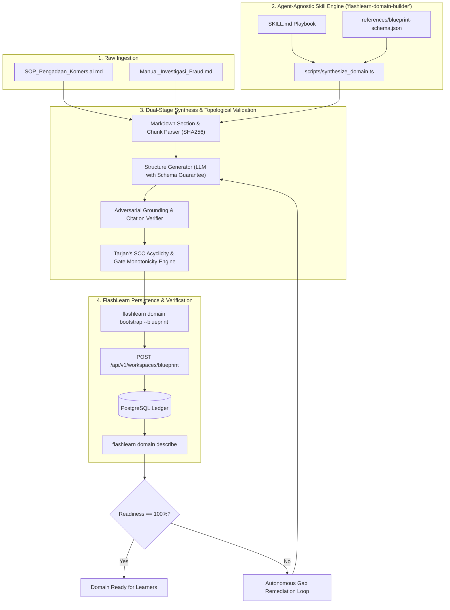

# User Story & End-to-End Design: Markdown Domain Ingestion & Curriculum Synthesizer
**Agent-Agnostic Operational Competency Engineering**
**Standard: October 2026 Agent Skills Standard (Agentic AI Foundation)**

---

## 1. User Story Overview

### 1.1 The High-Consequence Domain Problem
Organizations operating in regulated, mission-critical domains (such as government procurement under LKPP Perpres 16/2018, aviation maintenance under FAA/EASA Part 145, clinical clinical protocols, or financial audit compliance) possess extensive procedural documentation in Markdown or standard text.

However, transforming an unstructured 50-page SOP into an **objectively verifiable, multi-tiered learning and certification system** is a painstaking, months-long endeavor. Human instructional designers often:
- Create superficial multiple-choice questions that encourage memorization rather than operational competence.
- Fail to model prerequisite dependency hierarchies, allowing junior practitioners to attempt advanced procedures without foundational skills.
- Miss critical regulatory omissions and adversarial failure modes (e.g. vendor deception, missing certificates, urgency pressure).

### 1.2 User Story Statement
> **AS A** Lead Domain Trainer, Regulatory Auditor, or Instructional Engineering Team  
> **I WANT TO** provide one or more raw statutory / SOP documents in Markdown format to an autonomous coding agent  
> **SO THAT** the agent can automatically deconstruct the text into a cryptographically anchored, cycle-free prerequisite DAG, generate Class A/B/C and adversarial stress-testing tasks with Socratic anti-spoiler shields, establish progressive authorization gates, and prove 100% domain readiness via deterministic CLI verification—with zero human authoring bottleneck and zero domain hardcoding.

---

## 2. Acceptance Criteria (Gherkin Specification)

```gherkin
Feature: End-to-End Autonomous Domain Synthesis from Markdown Regulations

  Scenario: Ingesting Markdown Regulation and Synthesizing a Complete Verified Domain
    Given one or more statutory SOP documents in Markdown format with standard headings (Pasal, Bab, # Headers)
    And a running FlashLearn instance and configured @flashlearn/cli
    When the autonomous coding agent triggers the "flashlearn-domain-builder" skill
    And executes the domain synthesis workflow for the target workspace
    Then the system must parse and chunk the Markdown documents with SHA256 content hashes
    And synthesize discrete competency nodes structured across Bloom's Taxonomy:
      | Gate Level | Cognitive Tier | Oracle Class | Task Archetype |
      | Gate 1     | Remember / Apply | Class A      | Deterministic Formulas & Verification Checklists |
      | Gate 2     | Analyze / Evaluate | Class B    | Case Studies with Negative Anchors (Traps) |
      | Gate 3     | Synthesize / Defend | Class C / Adv| Double-Blind Capstone & Adversarial Stress Dilemmas |
    And build a Directed Acyclic Graph (DAG) with zero circular dependencies (Tarjan's SCC |C_i| = 1)
    And construct Socratic Anti-Spoiler Shields that cite exact source chunk hashes without leaking gold solutions
    And configure progressive Gate Passports (Level 1, 2, and 3)
    And verify that `flashlearn domain describe <workspace-id>` outputs:
      | Metric | Required Value |
      | Cycle Detected | false |
      | Orphan Competencies | 0 |
      | Missing Gate Coverage | 0 |
      | Domain Readiness Score | 100% |
```

---

## 3. End-to-End Workflow Architecture



---

## 4. Agent Skills Standard Research & Best Practices (October 2026)

Our research into the open **Agent Skills standard** (governed via the Agentic AI Foundation) reveals five essential principles for agent-agnostic skills:

1. **Progressive Disclosure Pattern**:
   Agents should not have hundreds of pages of documentation dumped into their context window at once.
   - `SKILL.md`: Kept concise, imperative, and actionable. Acts as a high-level roadmap and router.
   - `references/`: Deep technical schemas, JSON examples, and prompt templates are stored in sub-files and read on demand.
   - `scripts/`: Complex, deterministic calculations (such as parsing Markdown headings or validating Tarjan's SCC) are packaged as executable scripts rather than prompting the LLM to write ad-hoc bash one-liners.

2. **Agent-Agnostic Tool Invocation**:
   The skill must avoid tool lock-in. Instead of assuming proprietary IDE tools, the skill instructs the agent using standard UNIX CLI primitives (`flashlearn <noun> <action> --json` or `bun run scripts/...`). This enables identical execution across **Antigravity CLI**, **Claude Code**, **Cursor**, **Codex**, **Windsurf**, and **Aider**.

3. **Machine-Readability & Typed Exit Codes**:
   Every CLI command executed by the skill emits pristine JSON envelopes on `stdout` and typed error envelopes on `stderr`. Semantic exit codes (0 = Success, 64 = Validation Error, 127 = Command Not Found) allow the agent to self-heal without parsing free-form English errors.

4. **Zero Interactivity**:
   Scripts and CLI commands must never block on interactive `stdin` prompts (`[y/N]`). All actions support `--yes`, `--force`, and non-interactive JSON flags.

5. **Self-Contained Portability**:
   The skill directory contains everything required to complete the task: metadata, documentation, schemas, and helper scripts, maintaining zero external dependencies beyond Bun/Node.js and the FlashLearn CLI.
