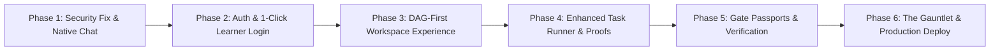

# User Story & End-to-End Implementation Roadmap: Learner Journey & Security Remediation
**FlashLearn: High-Assurance Competency & Active Recall Platform**
**Standard: October 2026 Agent Skills Standard (Agentic AI Foundation)**

---

## 1. Executive Summary & Problem Context

FlashLearn is an enterprise-grade learning and competency verification platform. In high-consequence domains (such as Government Procurement, Corporate Strategic Sourcing, and Statutory Audit), learners must navigate a strict Directed Acyclic Graph (DAG) of prerequisite skills, pass multi-tiered Oracle evaluations (Class A deterministic checks, Class B AI rubrics with negative anchors, and Class C expert reviews), clear progressive authorization gates, and prove resilience against adversarial integrity dilemmas.

### Critical Security Finding & Remediation
Prior to this release, FlashLearn embedded an unauthenticated cross-origin iframe to `chat.dvlpid.my.id/embed/chat`. Due to browser cookie transmission (`SameSite=Lax` on `lumis_user=admin`), visitors opening FlashLearn on machines with existing admin sessions immediately inherited **Super Admin** privileges in the Lumis widget. This roadmap permanently replaces the insecure iframe with a **Native In-App Socratic AI Engine** that communicates directly with FlashLearn's secure, domain-prompt-aware API (`POST /api/v1/tasks/:id/socratic-hint`), completely eliminating cross-origin privilege bleeding.

---

## 2. TO-BE User Stories (BDD Specification)

### `US-L01`: Frictionless Onboarding & Multi-Provider Identity
* **As a** Prospective Learner (Procurement Specialist / Corporate Auditor),  
* **I want to** explore public domains and authenticate effortlessly via SSO, Google GIS, or a 1-Click Verified Learner Demo,  
* **So that** my competency graph, gate passports, and mastery credentials are cryptographically persisted to my identity.
* **Shortest Path UX**:
  * **Path Length**: 1 click from Hero CTA $\rightarrow$ Authenticated state $\rightarrow$ Active Domain.
* **Acceptance Criteria (BDD)**:
  * **Given** an unauthenticated visitor on `https://learn.dvlpid.my.id`,
  * **When** viewing the landing page,
  * **Then** the catalog displays accredited workspaces and clear "Mulai Belajar" actions.
  * **And when** clicking "Masuk sebagai Pembelajar",
  * **Then** the system authenticates via `POST /api/v1/auth/demo-login` (or Google GIS) and provisions a session token.
* **AST Verification Targets**:
  * Frontend: `NavbarAuth.svelte`, `auth.svelte.ts`
  * Backend: `auth.controller.ts`, `resolveAuth.ts`

---

### `US-L02`: Domain Selection & Competency DAG Orientation
* **As an** Authenticated Learner,  
* **I want to** open a domain workspace (e.g. *Enterprise Level Procurement*) and immediately see the **Peta Kompetensi (DAG)** as the primary view,  
* **So that** I understand the prerequisite hierarchy, which nodes are ready to attempt, and which gates are currently locked.
* **Shortest Path UX**:
  * **Path Length**: 1 click from Workspace card $\rightarrow$ Competency DAG renders with node statuses.
* **Acceptance Criteria (BDD)**:
  * **Given** a learner opening `/workspace/:id`,
  * **When** the workspace view mounts,
  * **Then** the primary active tab is `competencies` (Competency DAG),
  * **And** root node `PROC-ENT-01` displays status `ready`, while dependent nodes display `locked`,
  * **And** edge relationships accurately reflect the Tarjan cycle-free DAG.
* **AST Verification Targets**:
  * Frontend: `workspace.svelte`, `CompetencyDagView.svelte`
  * Backend: `competency.controller.ts`, `GetCompetencyGraphUseCase.ts`

---

### `US-L03`: Focused Task Studio & Native Socratic Dialectic Guidance
* **As a** Learner attempting an operational task,  
* **I want to** analyze the statutory scenario, reference the Corpus of Record, and consult a Socratic Mentor directly within the platform,  
* **So that** I overcome conceptual blockers through dialectical questions without having answers spoiled.
* **Shortest Path UX**:
  * **Path Length**: 1 click on "Ready" node $\rightarrow$ Task Studio $\rightarrow$ Socratic Guidance available inline.
* **Acceptance Criteria (BDD)**:
  * **Given** an active task modal or studio view,
  * **When** the learner queries the Socratic AI drawer,
  * **Then** the request calls `POST /api/v1/tasks/:id/socratic-hint`,
  * **And** the response enforces domain-specific `socraticConfig` (Do's & Don'ts, anti-spoiler shield),
  * **And** zero iframe or cross-origin admin cookies are loaded.
* **AST Verification Targets**:
  * Frontend: `TaskExecutionForm.svelte`, `SocraticTutorDrawer.svelte`, `LumisChatAssistant.svelte`
  * Backend: `task.controller.ts`, `AskSocraticTutorUseCase.ts`

---

### `US-L04`: Multi-Tier Oracle Evaluation & Cryptographic Audit Proof
* **As a** Learner submitting a solution,  
* **I want** an impartial, strict Oracle evaluation (Class A deterministic or Class B AI Judge) with immediate feedback and Merkle audit proof,  
* **So that** my score is earned objectively and downstream prerequisites unlock automatically.
* **Shortest Path UX**:
  * **Path Length**: Submit solution $\rightarrow$ Real-time Oracle grade $\rightarrow$ FIPS 180-4 Merkle Root Hash $\rightarrow$ Prerequisite unlocked.
* **Acceptance Criteria (BDD)**:
  * **Given** a completed task submission,
  * **When** the Oracle evaluates the attempt,
  * **Then** the result includes score, pass/fail status, and immutable audit hash,
  * **And** downstream dependent competencies unlock on the DAG.
* **AST Verification Targets**:
  * Frontend: `TaskExecutionForm.svelte`
  * Backend: `task.controller.ts`, `EvaluateAttemptUseCase.ts`, `OracleEvaluatorClassB.ts`

---

### `US-L05`: Adversarial Stress Dilemma & Gate Passport Issuance
* **As a** Learner reaching the capstone of a domain,  
* **I want to** resolve an adversarial pressure scenario (e.g. Year-End Budget Urgency vs. Compliance),  
* **So that** I earn a verified Gate Level 3 Passport certifying operational authority.
* **Shortest Path UX**:
  * **Path Length**: Complete adversarial capstone $\rightarrow$ Gate Level 3 Passport Issued $\rightarrow$ Verifiable credential QR.
* **Acceptance Criteria (BDD)**:
  * **Given** all prerequisite nodes mastered,
  * **When** passing the adversarial dilemma task,
  * **Then** `GET /api/v1/gates/workspace/:id/passport` returns level 3 clearance,
  * **And** the Gate Passports view renders the digital credential.
* **AST Verification Targets**:
  * Frontend: `GatePassportsView.svelte`, `TaskExecutionForm.svelte`
  * Backend: `gate.controller.ts`, `EvaluateGatePassportUseCase.ts`

---

## 3. Implementation Phases & Roadmap

### Phase 1: Security Remediation & Native Socratic Engine
- Eliminate iframe in `LumisChatAssistant.svelte`.
- Replace with a sleek, native Svelte 5 chat component that directly queries `POST /api/v1/tasks/:id/socratic-hint`.
- Wire `lumisChat.svelte.ts` store directly to FlashLearn API without external iframe dependencies.

### Phase 2: Frictionless Authentication
- Implement `POST /api/v1/auth/demo-login` in `auth.controller.ts`.
- Add 1-Click "Masuk sebagai Pembelajar" button in `NavbarAuth.svelte` and landing hero.

### Phase 3: DAG-First Workspace UX
- Set `activeViewTab = 'competencies'` as default in `workspace.svelte`.
- Ensure DAG loads immediately upon navigating to any workspace.

### Phase 4: Enhanced Task Runner & Audit Proof
- Display Merkle Root SHA-256 hash and audit clearance badge in `TaskExecutionForm.svelte`.
- Provide smooth draft adoption from Socratic guidance into answer fields.

### Phase 5: Gate Passports & Credential Cards
- Enhance `GatePassportsView.svelte` with visual credential status and milestone indicators.

### Phase 6: Automated Verification & Deployment
- Run `bun run build`, `bun run lint:srp`, `detect-mocks .`.
- Dual-remote push to `origin` & `bps`.
- Deploy via `agy-ops deploy flashlearn --wait`.
