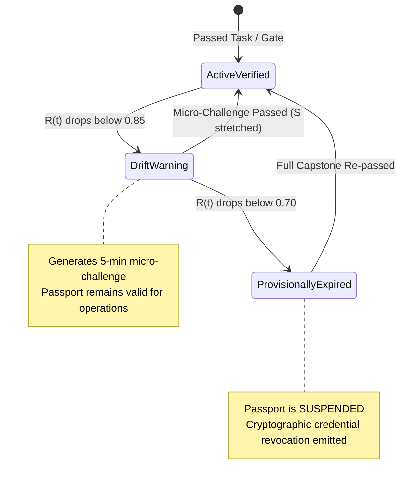

# Phase 14: Predictive Competency Drift & Skill Half-Life Decay Modeling
**Research Foundation, Cognitive Decay Mathematics, and Implementation Specification**
**Standard: October 2026 DSR (Difficulty, Stability, Retrievability) Competency Modeling**

---

## 1. Executive Summary & Research Foundation

### 1.1 The Illusion of Lifetime Certification
In conventional enterprise learning management systems, a certificate or gate clearance is treated as a permanent binary state: once passed, the user is considered "certified forever" (or subject to an arbitrary, non-scientific 3-year expiration).

In mission-critical operations (e.g., flight crew emergency procedures, high-risk government procurement auditing, acute cardiac triage, cyber incident response), **operational competence is a perishable state**. Procedural recall, situational vigilance, and fine-grained regulatory boundaries decay over time if not exercised.

### 1.2 State-of-the-Art Benchmark (October 2026)
Modern cognitive psychometrics and memory engineering adapt the **DSR (Difficulty, Stability, Retrievability) Model** (popularized by FSRS-4.5/5) from atomic flashcards to **complex, multi-modal operational competencies**:
- **Difficulty ($D$)**: Reflects the intrinsic cognitive complexity and procedural nuance of the competency.
- **Stability ($S$)**: Measures the duration (in days) over which the learner's operational retrievability remains above the enterprise safety threshold ($90\%$).
- **Retrievability ($R(t)$)**: The real-time mathematical probability that the practitioner can successfully execute the operational competency at time $t$.
- **Automated Micro-Revalidation Traps**: Instead of forcing a practitioner to retake an entire 40-hour course upon expiration, the system delivers high-impact **5-minute micro-scenarios** when $R(t)$ enters the warning zone, dynamically resetting stability upon successful defense.

---

## 2. Mathematical & Algorithmic Formulation

### 2.1 The Competency DSR Variables
For each learner-competency pair $(u, c)$:
1. **Difficulty ($D \in [1, 10]$)**:
   $$D = \min\left(10, \max\left(1, D_{\text{base}} + \Delta_{\text{complexity}}\right)\right)$$
   Where $D_{\text{base}}$ is determined by the task cognitive tier (Bloom’s taxonomy: *Remember=2, Apply=4, Evaluate/Create=8*), and $\Delta_{\text{complexity}}$ is adjusted by historical cohort failure rates.
2. **Stability ($S \ge 1.0$)**:
   The memory durability in days. Initial stability $S_0$ upon first passing a task:
   $$S_0 = S_{\text{init}}(D)$$
3. **Power Forgetting Curve ($R(t)$)**:
   Given elapsed time $t$ (days) since the last validated operational performance:
   $$R(t) = \left( 1 + 0.19 \cdot \frac{t}{S} \right)^{-0.5}$$
   *(When $t = S$, $R(S) \approx 0.90$.)*

### 2.2 Stability Update Function on Revalidation Attempt
When the learner completes a revalidation attempt with score grade $G \in \{ \text{FAILED}, \text{HARD}, \text{GOOD}, \text{EASY} \}$:
- **Successful Demonstration ($G \in \{ \text{GOOD}, \text{EASY} \}$)**:
  $$S' = S \cdot \left( 1 + \alpha \cdot D^{-\beta} \cdot S^{-\gamma} \cdot e^{w \cdot (1 - R(t))} \right)$$
  *Crucial insight: Successfully performing a task when retrievability has dropped low ($1 - R(t)$ is high) induces the greatest stability boost.*
- **Lapse / Operational Failure ($G = \text{FAILED}$)**:
  $$S' = \max\left(1.0, \quad S \cdot \delta_{\text{lapse}} \cdot D^{-0.2}\right)$$
  Stability collapses, reflecting that operational readiness has broken down.

### 2.3 Operational State Machine & Passport Impact


---

## 3. Architecture & Implementation Plan

### 3.1 Domain Layer (`apps/api/src/domain/`)
1. **Value Object**: `CompetencyMemoryState.ts`
   - Fields: `difficulty: number`, `stability: number`, `lastDemonstratedAt: Date`, `calculatedRetrievability: number`.
   - Methods: `computeRetrievability(now: Date): number`, `updateOnAttempt(grade, now): CompetencyMemoryState`.
2. **Domain Service**: `CompetencyDriftEngine.ts`
   - Pure stateless mathematical functions implementing DSR decay and interval optimization.
3. **Domain Event**: `CompetencyDriftWarningEvent`, `PassportProvisionallySuspendedEvent`.

### 3.2 Application Layer (`apps/api/src/application/`)
1. **Background Job / Use Case**: `ProcessCompetencyDecayBatchUseCase.ts`
   - Queries all active user competencies.
   - Computes $R(t)$.
   - Updates cached retrievability in bulk.
   - Dispatches drift warnings and provisional suspensions.
2. **Micro-Revalidation Dispatcher**: `DispatchMicroChallengeUseCase.ts`
   - Generates an instant, highly-targeted adversarial dilemma or diagnostic probe when a learner enters `DRIFT_WARNING`.

### 3.3 Persistence & Infrastructure Layer (`apps/api/src/infrastructure/`)
1. **Prisma Schema Update**:
   ```prisma
   model UserCompetencyMastery {
     id                 String    @id @default(uuid())
     userId             String
     competencyId       String
     status             String    // ACTIVE, DRIFT_WARNING, SUSPENDED_DRIFT
     difficulty         Float     @default(5.0)
     stability          Float     @default(30.0) // Days
     lastDemonstratedAt DateTime  @default(now())
     cachedR            Float     @default(1.0)
     updatedAt          DateTime  @updatedAt

     @@unique([userId, competencyId])
     @@index([userId, status])
     @@index([cachedR])
   }
   ```
2. **Worker Scheduling**:
   - Register recurring cron in `apps/api/src/worker.ts` running daily at midnight or every 6 hours.

### 3.4 CLI Interface (`@flashlearn/cli`)
1. **Drift Audit Commands**:
   ```bash
   # Audit competency decay across a workspace
   flashlearn competency drift-audit --workspace <ws-id> --threshold 0.85

   # Inspect a learner's dynamic competency half-life radar
   flashlearn competency memory-state --user <user-id> --workspace <ws-id>
   ```

---

## 4. Verification & Testing Gauntlet

### 4.1 Automated Hermetic Test Cases (`apps/api/tests/competency_drift.test.ts`)
1. **RED -> GREEN Case 1 (Decay Curve Validation)**:
   - Create competency with $S = 30$ days.
   - Fast-forward time $t = 30$ days.
   - Assert: $R(30) \approx 0.90 \pm 0.02$.
   - Fast-forward time $t = 90$ days.
   - Assert: $R(90) < 0.75$, status transitions to `DRIFT_WARNING`.
2. **RED -> GREEN Case 2 (Spaced Retrieval Stability Stretch)**:
   - Learner successfully passes a revalidation challenge at $R = 0.80$.
   - Assert: $S' > S \times 1.8$ (stability expands significantly).
3. **RED -> GREEN Case 3 (Lapse Collapse & Passport Suspension)**:
   - Learner fails challenge.
   - Assert: $S' \le 3.0$ days, passport is provisionally suspended.

### 4.2 Quality & SRP Verification
- Run static SRP analyzer: `bun run lint:srp`.
- Ensure `CompetencyDriftEngine.ts` stays under 150 lines without database or external I/O dependencies.
