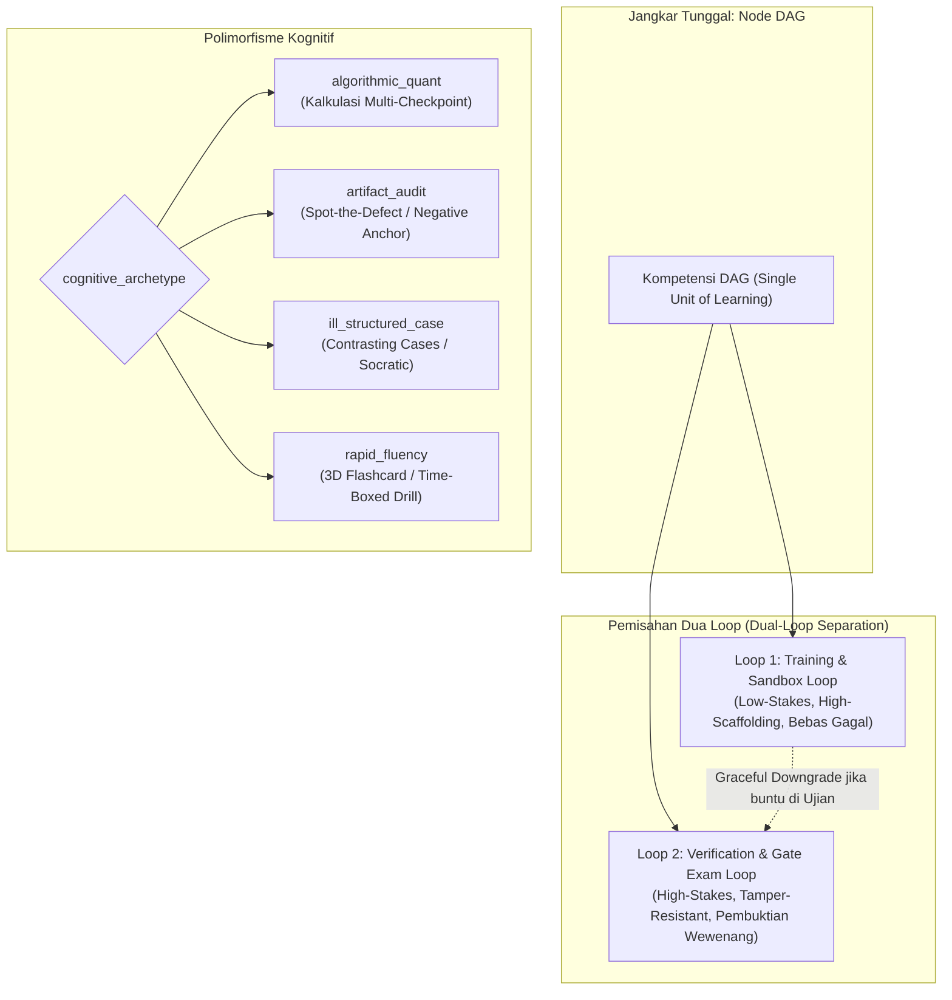

# Roadmap Arsitektur Kognitif FlashLearn (v2.0)
> **Pemberantasan *The Assessment-as-Instruction Fallacy* & Penerapan *Dual-Loop Learning Architecture* Berbasis 4 Arketipe Kognitif Universal**  
> *Standar: Oktober 2026 | Sifat: 100% Domain-Agnostic Engine*

---

## 1. Latar Belakang & Evaluasi Masalah

Kurikulum pelatihan korporat dan e-learning konvensional sering kali mengidap cacat perancangan mendasar:
1. **The Assessment-as-Instruction Fallacy**: Menyamakan "ujian berat dan simulator ketat" dengan "proses belajar". Ujian bukanlah instruksi; ujian hanyalah alat ukur.
2. **Sindrom *"Draw the Rest of the Owl"***: Memberikan teori pasal dan modul singkat di awal, lalu langsung menuntut peserta menyelesaikan skenario multi-variabel tingkat tinggi tanpa contoh pengerjaan terbedah (*worked example*) dan latihan bertahap (*faded scaffolding*).
3. **Pemisahan Semu Antara Materi dan Tugas**: Di antarmuka, modul bacaan dan tugas evaluasi ditaruh pada tab yang terpisah, memaksa pembelajar menebak-nebak materi mana yang relevan untuk menyelesaikan tugas tertentu.

Roadmap ini merombak arsitektur FlashLearn agar berfungsi sebagai **Mesin Magang Kognitif (*Cognitive Apprenticeship Engine*)** yang memisahkan secara tegas antara **Ruang Latihan Bebas Penalti (*Training Loop*)** dan **Ruang Pembuktian Sertifikasi (*Verification Loop*)**.

---

## 2. Invarian Arsitektur Utama

1. **100% Domain-Agnostic**: Kode engine, skema database, dan komponen UI dilarang keras memuat logika bisnis atau istilah spesifik industri (misal: dilarang hardcode aturan pengadaan, kedokteran, atau pemrograman di core engine).
2. **Node DAG sebagai Single Unit of Learning**: Modul materi, contoh terbedah, latihan bebas, dan ujian resmi disatukan di bawah satu entitas Node Kompetensi DAG.
3. **Pemisahan Perilaku AI Tutor**:
   - Di Loop 1 (Latihan): AI Tutor bersikap ekspansif, mendemonstrasikan contoh analogis, dan membimbing langkah demi langkah.
   - Di Loop 2 (Ujian Gate): AI Tutor dilarang membocorkan rumus/langkah. Bantuan langkah kerja memicu **Graceful Downgrade to Practice Mode**.
4. **Procedural Parity Invariant**: Ujian di Loop 2 dilarang menuntut operasi yang belum pernah dicontohkan di Loop 1.

---

## 3. Matriks 4 Arketipe Kognitif Universal (`cognitive_archetype`)

| Arketipe Kognitif | Sifat Masalah | Komponen Loop 1 (Mode Belajar & Latihan) | Evaluasi Loop 2 (Ujian Pembuktian Gate) |
| :--- | :--- | :--- | :--- |
| **`algorithmic_quant`** | Kuantitatif berurutan (TCO, dosis obat, DCF). | Formula Checklist + Bedah Kasus Ahli + Micro-Sandbox. | Multi-Checkpoint Oracle (Input modular dengan diagnostik presisi). |
| **`artifact_audit`** | Inspeksi dokumen/kepatuhan (P2P, security review, EKG). | Checklist Cacat + Contoh Dokumen Dianotasi. | Spot-the-Defect / Negative Anchor Oracle. |
| **`ill_structured_case`** | Dilema etika, hukum, krisis PR, investigasi. | Contrasting Cases (Studi kasus gagal vs ahli). | Adversarial / Open Rubric Oracle. |
| **`rapid_fluency`** | Ingatan deklaratif bertekanan waktu (Aviasi, kontraindikasi obat). | 3D Flashcard Deck & Spaced Retrieval (Model DSR). | Time-Boxed Fluency Test (100% akurasi di bawah batas waktu). |

---

## 4. Daftar Fase Implementasi

Dokumentasi detail setiap fase dipecah ke dalam file bernomor terpisah:

1. **[Fase 1: Skema Database & Kontrak Data Polimorfik](01_phase1_cognitive_archetypes_and_schema.md)**  
   *Penambahan enum `cognitive_archetype`, pengikatan materi belajar ke Node DAG, dan migrasi Drizzle.*
2. **[Fase 2: Redesain UI Dual-Loop Modal (`TaskRunnerModal`)](02_phase2_dual_loop_ui_task_runner.md)**  
   *Penyatuan Tab Belajar & Latihan vs Tab Ujian Pembuktian Gate serta protokol Graceful Downgrade.*
3. **[Fase 3: Generator Backward Scaffolding](03_phase3_backward_scaffolding_generator.md)**  
   *Pipeline otomatis penurunan Isomorphic Worked Example dari Target Task untuk mengeliminasi authoring bottleneck.*
4. **[Fase 4: Engine Auditor Kurikulum (Procedural Parity Check)](04_phase4_procedural_parity_auditor.md)**  
   *Audit deterministik pra-rilis untuk menjamin tidak ada ujian yang melompat tanpa contoh materi.*
5. **[Fase 5: Validasi Empiris Lintas 2 Domain Kontras](05_phase5_contrasting_domains_validation.md)**  
   *Uji coba komprehensif pada domain Pengadaan Korporat vs Aviasi/Kedokteran membuktikan 100% domain-agnosticism.*
