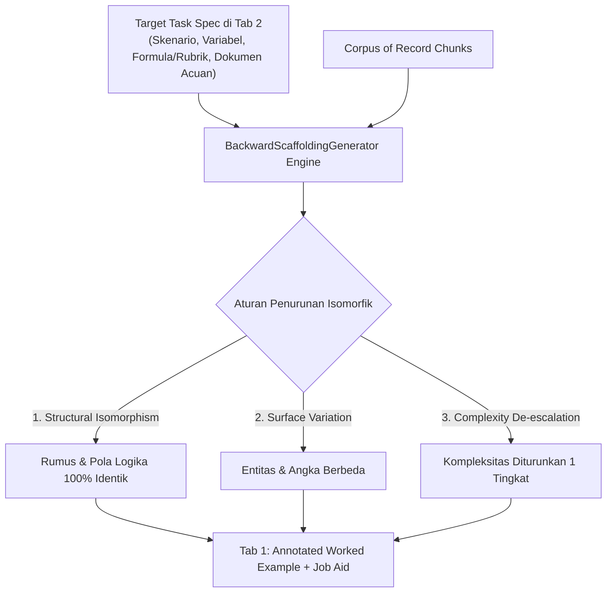

# Fase 3: Generator Backward Scaffolding (Authoring Engine)
> **Bagian dari [Roadmap Arsitektur Kognitif FlashLearn v2.0](00_overview.md)**  
> *Target: Core Domain Engine, Task-First Pipeline, Eliminasi Authoring Bottleneck*

---

## 1. Tujuan Fase
1. Mengatasi **Authoring Bottleneck** (beban kerja berlebih) yang dihadapi pembuat kurikulum (*Subject Matter Expert / Creator*).
2. Membalikkan alur pembuatan konten (*Task-First Backward Design*): Kreator cukup mendefinisikan Target Tugas Ujian (Tab 2) dan dokumen acuan (*Corpus of Record*), kemudian sistem secara otomatis menurunkan (*derives*) materi latihan dan *Isomorphic Worked Example* untuk Tab 1.
3. Menjamin **Procedural Parity**: Mustahil terjadi jurang materi vs tugas karena contoh pengerjaan di Tab 1 diturunkan langsung dari spesifikasi tugas di Tab 2.

---

## 2. Rincian Teknis & Alur Algoritma

### A. Komponen Service: `BackwardScaffoldingGenerator`
* Terletak di `apps/api/src/application/services/BackwardScaffoldingGenerator.ts`.
* Menerima input:
  - `taskSpec`: Skema evaluasi task (rumus, checklist, rubrik).
  - `sourceChunks`: Klausul regulasi atau SOP terkait.
  - `cognitiveArchetype`: Arketipe kognitif node.
* Output:
  - `workedExample`: Kasus contoh yang diselesaikan langkah demi langkah beserta catatan anotasi (*"Dari mana angka ini didapat, kesalahan umum apa yang sering terjadi"*).
  - `jobAid`: Lembar kerja operasional ringkas (checklist atau kartu rumus).
  - `microSandbox`: Kasus latihan terbuka dengan 1-2 variabel lebih sedikit dibanding tugas ujian asli.

### B. Integrasi ke Blueprint Importer & Domain Builder
* Di `ImportDomainBlueprintUseCase.ts` dan CLI:
  * Jika sebuah blueprint hanya mendefinisikan node dan tasks tanpa menyertakan modul manual, engine secara otomatis memicu `BackwardScaffoldingGenerator` untuk memproduksi Tab 1 secara otomatis saat blueprint diimpor.

---

## 3. Kriteria Keberhasilan (Acceptance Criteria)

- [ ] Generator mampu memproduksi *Isomorphic Worked Example* yang valid untuk setiap arketipe kognitif.
- [ ] Kasus contoh di Tab 1 terbukti tidak membagikan angka/kunci jawaban mentah yang sama persis dengan Tab 2 (menghindari *template matching*), namun mempertahankan struktur matematika/hukum yang identik.
- [ ] Kreator dapat mempublikasikan domain lengkap hanya dengan mendefinisikan skenario ujian dan dokumen acuan.
