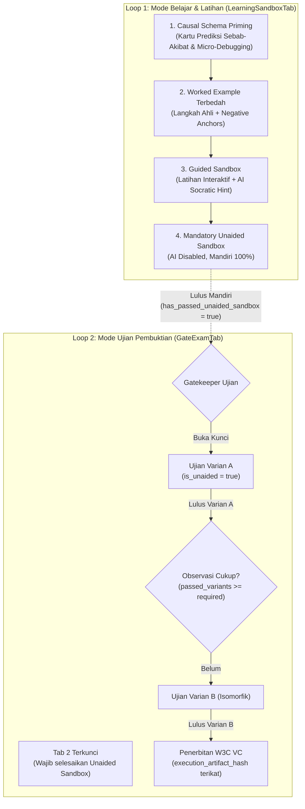

# Fase 6: Causal Schema Priming, Mandatory Unaided Sandbox, & Multi-Observation Entrustment
> **Penutupan Celah Ilusi Kompetensi (The AI Crutch & Knowing-Doing Gap) dan Penjaminan Kepercayaan Kerja Nyata**  
> *Standar: Oktober 2026 | Sifat: 100% Domain-Agnostic Engine*

---

## 1. Latar Belakang & Landasan Bukti

Hasil meta-analisis dan eksperimen terkini menunjukkan:
1. **The AI Crutch Effect (*Bastani et al., 2025*)**: Pembelajar yang didampingi AI Tutor selama latihan menunjukkan performa tinggi semu saat dibantu, namun anjlok drastis (-17%) saat AI ditarik pada tes independen. Solusinya adalah **Mandatory Unaided Practice Gate** sebelum ujian resmi dibuka.
2. **Causal Schema Priming (*Borders et al., 2024; Anderson, 1982*)**: Pengetahuan deklaratif hanya dapat ditransfer menjadi prosedur kerja jika pembelajar dipaksa membuat prediksi sebab-akibat (*What-If predictions*), membandingkan struktur analogis (*analogical comparison*), dan mendiagnosis anomali (*micro-debugging*) sebelum eksekusi.
3. **Multi-Observation Entrustment (*Mazzone et al., 2020; Ryan et al., 2024*)**: Satu kali lulus tugas rawan *lucky guess* atau *surface pattern matching*. Verifikasi wewenang operasional wajib menuntut kelulusan konsisten lintas minimal 2 varian kasus isomorfik (*Variant A & Variant B*).
4. **Zero-Domain Hardcoding (*ADR-07*)**: Seluruh konten spesifik industri (kedokteran, perpajakan, audit, aviasi) wajib digenerate dan disertifikasi secara deterministik melalui Autonomous Coding Agent CLI (`packages/cli`), menjaga inti engine FlashLearn 100% netral domain.

---

## 2. Invarian Arsitektur & Target Perubahan

---

## 3. Rincian Sub-Fase & Status Eksekusi

### 3.1 Sub-Fase 6.1: Skema Database & Repositori (Status: SELESAI ✅)
- `spaced_flashcards`: Menambahkan `card_type` (enum: `definition`, `causal_prediction`, `analogical_comparison`, `micro_debugging`), `prediction_options` (jsonb), dan `causal_rationale` (text).
- `tasks`: Menambahkan `scenario_variant_code` (text, default `'variant_a'`) dan `is_isomorphic_variant` (boolean).
- `attempts`: Menambahkan `is_unaided` (boolean), `ai_hints_used_count` (integer), dan `is_practice` (boolean).
- `gate_requirements`: Menambahkan `required_observations_count` (integer, default `1`).
- `mastery_records`: Menambahkan `has_passed_unaided_sandbox` (boolean) dan `passed_variant_codes` (jsonb array).
- `issued_credentials`: Menambahkan `execution_artifact_hash` (text) dengan indeks terdedikasi.
- Repositori Drizzle (`DrizzleSpacedFlashcardRepository`, `DrizzleMasteryRepository`, `DrizzleTaskRepository`, `DrizzleAttemptRepository`, `DrizzleGateRepository`, `DrizzleCredentialRepository`) telah disinkronkan 100%.

### 3.2 Sub-Fase 6.2: Layanan Evaluasi & Invarian Backend (Status: ON-GOING 🔄)
- **Unaided Sandbox Assessment**: Endpoint evaluasi tugas latihan menandai `is_practice: true` dan `is_unaided: true`. Jika lulus passing score, memperbarui status `mastery_records.has_passed_unaided_sandbox = true`.
- **Multi-Observation Progression**: Saat evaluasi Gate Exam lulus, menambahkan `scenario_variant_code` ke `passed_variant_codes`. Status kompetensi menjadi `mastered` hanya jika `passed_variant_codes.length >= required_observations_count`.
- **Credential Integrity Binding**: Mengaitkan Merkle root audit trail ke `issued_credentials.execution_artifact_hash`.

### 3.3 Sub-Fase 6.3: Sertifikasi Blueprint Domain via Coding Agent CLI (Status: TERENCANA 📋)
- `packages/cli` memperluas validator blueprint untuk memverifikasi kelengkapan:
  1. Minimal 1 set Causal Probes per kompetensi.
  2. Minimal 2 varian isomorfik (`variant_a` dan `variant_b`) untuk setiap tugas Gate.
  3. Lolos uji Tarjan SCC (bebas siklus).
  4. 0 kata kunci domain di hardcode engine platform.

### 3.4 Sub-Fase 6.4: Penegakan Antarmuka Pengguna (UI Enforcement) (Status: ON-GOING 🔄)
- **`apps/web/src/components/competency/LearningSandboxTab.svelte`**:
  - Penambahan seksi **Causal Schema Priming**: Komponen dek interaktif kartu *What-If* yang mewajibkan memilih hipotesis sebelum alasan kausal terbuka.
  - Penambahan langkah **Unaided Sandbox Checkpoint**: Status visual tegas bahwa AI dinonaktifkan untuk menguji kesiapan independen pembelajar.
- **`apps/web/src/components/competency/TaskRunnerModal.svelte`**:
  - Enforce tab lock: Tab 2 (Ujian Pembuktian Gate) dikunci secara deterministik jika `hasPassedUnaidedSandbox === false`.
  - Notifikasi bimbingan: Memberikan badge instruksi bahwa izin ujian hanya didapat setelah lulus latihan mandiri tanpa bantuan AI.
- **`apps/web/src/components/competency/GateExamTab.svelte`**:
  - Indikator Multi-Observation: Menampilkan badge progres observasi (misal: "Pengamatan 1 dari 2: Kasus Isomorfik Varian A").
  - Form submission otomatis mengirimkan flag `is_unaided: true` dan mencatat jumlah petunjuk AI (harus 0).

---

## 4. Protokol Verifikasi & Bukti Kepatuhan
1. **SRP & File Limit**: Seluruh file UI dan backend tetap di bawah batas 400 baris (`bun run lint:srp`).
2. **Zero-Mock & Zero-Hardcode**: `detect-mocks .` dan verifikasi bebas dependensi domain industri.
3. **Strict arc42 Alignment**: Dokumentasi arsitektur diverifikasi dengan `bun run lint:arc42:strict`.
4. **Hermetic Test Suite**: Seluruh unit test paket lulus tanpa regresi (`bun test packages/`).
